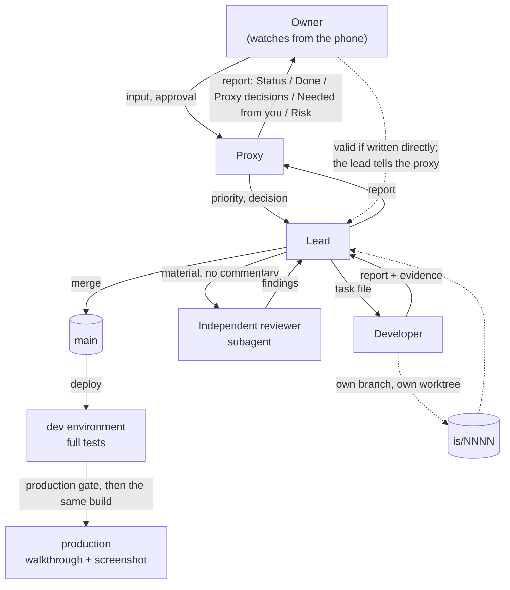

# ProxyTeam (VekilEkip): a three-session way of working with Claude Code

English · [Türkçe](KILAVUZ.md)

*Vekil* means proxy or delegate in Turkish; *ekip* means team, hence the repository name ProxyTeam.

VekilEkip is a method and a small toolkit for running a software project with three Claude Code sessions.
The owner talks to only one session, the **proxy** (vekil). The proxy makes routine decisions on the owner's behalf and passes them to the **lead** (lider).
The lead splits the work, reviews, merges and deploys. The **developer** (geliştirici) only writes code. The shared memory of all sessions is
the git repository; chat history is not trusted. The aim: the owner is not a bottleneck, decisions are not lost, sessions
stop and resume without loss, and work called "done" is done with evidence.

Quick setup: [QUICKSTART.en.md](QUICKSTART.en.md). Türkçe kılavuz: [KILAVUZ.md](KILAVUZ.md). A filled-in example: [ornek/](ornek/).

> **Status: experimental.** This kit is an experience report: it was used on two projects, by one person, for a few days.
> The benefits below are goals, not yet measured results. The kit now keeps the records needed to measure cost and gain
> itself. The first measurement entry is published on Friday 4 December 2026, and the next three on the three Fridays that follow: [MEASUREMENT-LOG.en.md](MEASUREMENT-LOG.en.md). Most of the parts (lead and worker sessions, worktrees,
> a separate reviewer, handoff notes) are known practices; this kit brings them together and puts a few rules on top.
> Some of the rules came from real incidents; the others were written against anticipated risks.

The kit itself is in Turkish: templates, script messages, file names, commands and setting keys. This guide leaves them as they are
and gives the English meaning in parentheses where a name first appears.

---

## What this kit contributes

**What is original (as far as we could find):** the proxy. Setups made of lead and developer sessions are known; in them the human talks directly
to the lead and every decision still comes back to the human. Here a separate session steps in between and makes routine decisions on the owner's behalf.
What it may decide is written down, every decision it makes goes on record, and everything beyond that boundary goes to the owner.
For similar work and the differences: [Similar work and where this kit stands](#similar-work-and-where-this-kit-stands).

**Four things it wants people to notice:**

1. **The bottleneck is often the human, not the model.** When every small decision comes to the human, the work moves at the human's pace. The question should be "which decision is really mine", not "how fast is the model".
2. **The human's word is also a claim.** The owner's "I logged in" was taken as true without being checked against a record, and it turned out to be wrong. Verification applies to everyone in the chain, not only to what the model says.
3. **Whoever does the work describes it optimistically.** That is why evidence is required and why a reviewer who does not know the conclusion looks before acceptance. That reviewer is the same model too; it reduces the blind spot, it does not remove it.
4. **Claiming without measuring is easy.** This kit also started by saying "it made things faster"; trying to measure after the fact showed how much the numbers depend on definitions, and the claim was withdrawn. A [measurement log](MEASUREMENT-LOG.en.md) was put in its place.

---

## Contents

1. 5W1H (What, Why, Who, Where, When, How)
2. Intended benefits
3. Requirements and cost
4. Rules and lessons
5. One account or several
6. Common mistakes
7. Limits
8. Suggested additions
9. Similar work and where this kit stands
10. What is in the kit

---

## 5W1H

### What?

A three-role Claude Code setup and a few rules that hold it together:

- **One line.** Owner → proxy → lead → developer. Every message goes through this line.
- **Proxy authority.** Routine decisions are the proxy's; decisions such as money, secrets and deleting data are the owner's.
- **Production gate.** Who deploys to production is set per project: the owner or the proxy.
- **The shared memory is the repository.** Status, decisions and tasks live in files in the repository.
- **Context cleanup.** When a large piece of work ends: handoff note, commit, `/clear`.
- **Break protocol.** When "Mola ver" (take a break) is said, all sessions wrap up and stop without loss; the goal is about 5 minutes (the time has not been measured). A script checks the result.
- **Independent reviewer.** Before acceptance, a subagent looks at the material with no commentary attached.
- **Verification.** No "it works" without evidence.
- **Measurement.** A short measurement section in every task file and a script that counts from the session logs. Results are published in the [measurement log](MEASUREMENT-LOG.en.md).

### Why?

| Problem | Symptom | What VekilEkip does about it |
|---|---|---|
| The owner is a bottleneck | Every small question comes to the owner; when the owner is away, work stops. | The proxy makes routine decisions and records them. Only the decisions that are really the owner's go to the owner. |
| Lost context and decisions | When a session closes or the context fills up, "why did we do it this way" is forgotten. | Status, handoff note and decisions are in the repository. A new session starts from there. |
| Decisions argued again | The same question is opened three times a week. | Numbered decision records. A decision that has been made is not reopened; if it must change, a new record is written. |
| Mistakes and optimistic reports | It is reported as "works", and it does not. The model thinks well of its own work. | The evidence rule and the independent reviewer. What the screenshot shows is what gets written. |
| Scope drift | A small job grows and swallows the ones waiting in line. | The lead splits the work into task files; what is out of scope is written down. The proxy sets priority. |
| Wasted quota | Every session reads the same files; the context swells. | The developer only writes code; review happens in the lead's subagents. Regular context cleanup. |
| Stopping safely while on the move | The owner wants to say "stop" from the phone; half-done work gets lost. | The break protocol and the check script. A deploy is never interrupted halfway. |

### Who?

| Role | What it does | What it decides | Who it writes to |
|---|---|---|---|
| **Owner** (human) | Sets direction, sees the result. | Money, secrets, deleting data, sending anything outside, decisions that are hard to undo, announcements and opening access, legal text, final visual and design approval, links that must be downloaded by hand, any change that collects or stores new personal data. Production deploys (unless authority in the project has been handed to the proxy). | Only to the proxy. |
| **Proxy** (session) | Takes the owner's input, reports, has claims verified. Does not write code; writes only its own report and the decision records. | Order of work and priority; technical approach; trying a free, openly licensed tool or asset; deploys to the dev environment; reversible design details that follow earlier criteria. Production deploys are set per project (see "Production deploy authority" below). Each one is recorded as a "vekil kararı" (proxy decision). | Only to the lead. |
| **Lead** (session) | Splits the work, writes tasks, reviews, merges, deploys, does a walkthrough after the deploy, runs the independent reviewer. Does not write code; writes the status file and the task files. | How a task is split, the outcome of a review, merging. | Tasks to the developer; reports to the proxy. |
| **Developer** (session) | Only writes code; on its own branch, in its own worktree. | Implementation details inside the task. | Reports to the lead. |

Two exceptions:
- If the owner writes directly to a session, that is valid. If the owner wrote to the developer, the developer tells the lead; the lead in turn tells the proxy. That keeps the proxy's picture complete.
- The owner may watch all three sessions (see "Owner monitoring" below).

### Where?

| Information | Place | Goes into the repository? |
|---|---|---|
| Current status, the lead's handoff note (only the lead writes it) | `docs/DURUM.md` (status) | Yes |
| Decisions | `docs/kararlar/NNNN-ad.md` (decisions; `ad` = name) | Yes |
| Task, report, review, the developer's handoff note | `docs/gorevler/NNNN-ad.md` (tasks) | Yes |
| Incidents and lessons | `docs/olaylar.md` (incidents) | Yes |
| Role prompts, independent reviewer prompt | `docs/ekip/` (team) | Yes |
| Team rules (every session reads them) | The "Ekip ve hat" (team and line) section in `CLAUDE.md` | Yes |
| The proxy's report to the owner and its handoff note | `yerel/vekil/rapor.md` (`yerel` = local, `rapor` = report) | No |
| Break record | `yerel/mola.json` | No |
| Deploy lock | `yerel/yayin.kilit` | No |
| Production approval | `yerel/canli-onay.json` | No |
| Secrets | Outside the repository or under `yerel/`; read only by tools | Never |
| Session memory, chat history | Claude Code's own folder | n/a |

**Why is session memory not trusted?** There are three reasons:
1. Each session's memory is separate. The other session cannot see it.
2. When the context fills up, or after `/clear`, the content is summarized or erased. A summary loses detail.
3. Memory cannot be audited. A file in the repository, on the other hand, can be read and compared, and it has a history.

The rule is simple: everything another session needs to know is written to the repository.

The `yerel/` folder is not an exception to this rule: only temporary things that belong to that machine live there (the break record, the lock, the production approval, the proxy's report to the owner). Everything that must be permanent, for example the decisions the proxy makes, is written under `docs/kararlar/` in the repository.

### When?

| Value | Kind of project |
|---|---|
| **Unnecessary** | A single-file script; a one-hour experiment; work one person will finish in a single session. For these the overhead of the setup is larger than its gain. |
| **Maybe** | Work of a few hours, in one piece. The shared memory rule alone (DURUM.md, decision records) is enough. |
| **Worthwhile** | A project that lasts several days or weeks, has many parts and gets deployed. Work the owner cannot watch over all the time. Work that needs visual or design acceptance. |

A sign: if the question "what did we decide yesterday?" has started to come up, or if the owner wants to manage from the phone,
this setup is useful.

### How?

#### Flow



As plain text:

```
Owner ──input──▶ Proxy ──priority──▶ Lead ──task──▶ Developer
  ▲               │ ▲                 │ ▲               │
  └────report─────┘ └─────report──────┘ └report+evidence┘
                                      │
      independent reviewer (subagent) ◀── material
                                      │
                             main ──▶ dev (full tests) ──production gate──▶ production (walkthrough, screenshot)
```

#### Message line

- Only tasks and short status go by message. Content is written to a file, and the message gives the path to the file.
- Example: the lead writes to the developer "Görev 0012: `docs/gorevler/0012-giris-formu.md` dosyasını oku." (Task 0012: read the file ...).
  When the developer finishes, it writes the report into the "Rapor" (report) section of the same file and sends the lead a single line.
- The proxy does not write to the developer. The developer does not write to the proxy. This prevents two separate instructions on the same subject.
- Every message between sessions starts with a label in capitals. Lead → proxy: `RAPOR` (report), `SORU` (question), `BİLGİ` (info) or `DÜZELTME` (correction). Developer → lead: `RAPOR`, `SORU` or `BİLGİ`. The reader can tell at once which message needs an answer and which one takes back an earlier statement; the measurement script counts the labels too.
- A decision sentence starts by saying whose it is: "Vekil kararı: ..." (proxy decision), "Lider kararı: ..." (lead decision), "Proje sahibi: ..." (owner).

#### Daily rhythm

| Time | What happens |
|---|---|
| Start | Each session reads `git log -5`, `docs/DURUM.md`, its own handoff note (developer: the task file; proxy: `yerel/vekil/rapor.md`) and the relevant decision. The role prompt is pasted from `docs/ekip/ilk-mesajlar.md` (first messages). |
| During the day | The owner writes to the proxy. The proxy decides or asks the owner, and passes it to the lead. The lead opens a task, the developer codes, the lead reviews and merges. |
| When a large piece of work ends | Handoff note, commit, `/clear`. |
| After a deploy | The lead does a walkthrough in the real environment, takes screenshots, gives them to the independent reviewer, reports to the proxy. |
| End of day or a long pause | The break protocol or context cleanup. The proxy writes the final report. |
| Once a week | A short retrospective (`docs/ekip/geriye-bakis.md`). |

#### Context cleanup

When: every time a large task ends, or before a pause longer than an hour.

1. The session updates its own **handoff note**: what was being done, half-done files, what was tried and did not work, the next concrete step. Each file, and in the task file each section, has a single writer: the lead writes `docs/DURUM.md`, the developer writes the "Devir notu" (handoff note) section in its own task file, the proxy writes `yerel/vekil/rapor.md`.
2. It commits the file in the repository (the proxy's report does not go into the repository and is not committed). If there is half-done work, the message says "yarım" (half-done).
3. `/clear`.
4. The role prompt is pasted. The session starts with `git log -5`, `DURUM.md`, its own handoff note and the relevant decision.

Why: a long context is read again at every step and eats quota. The expectation is that a session that starts clean works more accurately from the summary in the repository; this has not been measured, it is one user's observation.

#### Break

When "Mola ver" (take a break) is said, the goal is that all sessions stop without loss in about 5 minutes (the time has not been measured; it is an observation from two projects).

1. The owner writes "Mola ver." to the proxy.
2. The proxy passes it to the lead; the lead to the developer.
3. The check comes first: the lead runs `node araclar/mola.mjs` and sends its output to the proxy. The script lists, line by line, what has to stop, so the state is known even if a later step gets stuck.
4. Each session clears what is blocking: it shuts down running tests and servers, commits half-done work as "yarım: ...", and writes its own handoff note.
5. The lead runs the check again. On exit 0 it writes "güvende" (safe) and a one-line status to the proxy; on exit 1 it clears what is left and tries again.
6. Before passing "güvende" on to the owner, the proxy verifies the record itself: it looks at the exit code of `node araclar/mola.mjs` and at `yerel/mola.json`.

**If the commit hook will not let half-done work through, the hook is not skipped** (no `--no-verify`). Half-done work often fails type checks or tests. In that case the work is stashed together with its untracked files, and a patch of it is written to `yerel/mola-guvence/` in the main working copy; if the stash is dropped by mistake, the patch is the second copy:

```bash
git stash push -u -m "yarım: <ne yarım kaldı>"
mkdir -p <ana kopya>/yerel/mola-guvence
git stash show -p --include-untracked "stash@{0}" > <ana kopya>/yerel/mola-guvence/<dal>.patch
```

Here `<ana kopya>` is the main working copy, `<dal>` the branch name and `<ne yarım kaldı>` a few words on what is half done. In the file name, `/` in the branch name is written as `-` (needs Git 2.32 or later). The handoff note says where the stash and the patch are. On return, the owner of the branch restores the work in its own copy with `git stash pop`. The script lists a stash whose message starts with "yarım" as "pending half-done work", with its branch name; it does not block the break.

**A deploy is never interrupted.** Either it is finished or the previous version is restored. If the script sees the deploy lock, it delays the break.

When "Mola bitti" (the break is over) is said, the lead runs `node araclar/mola.mjs bitti`. The script checks whether the working copies are at the
commit recorded when the break began, and warns if there is stashed work (`git stash`). Everyone continues from their own handoff note.

What the script checks:

| Check | Result |
|---|---|
| Is every worktree clean | If dirty, **block** |
| Are the processes defined in the settings (tests, development server, Blender and the like) running inside a working copy | If running, **block** |
| Is there a deploy lock | If there is, **block** |
| Was the handoff note (`docs/DURUM.md`) committed in the last 30 minutes | If not, **warning** (can be made a block with `devirNotu.engel: true`) |
| Is there shelved work (`git stash`) | If there is, **warning**, with the branch name (the break does not see it). An entry whose message starts with "yarım" is listed first, as pending half-done work |
| Are there commits not pushed to the remote | **Warning** (a local commit is not lost) |
| Is there an unrecognized process inside a worktree | **Info** |

The script never kills a process. It only checks, and writes the state to `yerel/mola.json`. It looks only at processes of your own user.
Exit codes: 0 safe, 1 not safe, 2 usage or settings error.

Settings (`.vekilekip.json`; a field you give replaces the default):

| Field | What | Default |
|---|---|---|
| `uzak` | The remote looked at in the push check | `origin` |
| `surecler` | Process patterns that count as a block: `ad` (name), `kalip` (regular expression), `kapsam` (scope). `kapsam: "kopya"` counts only a process running inside a working copy; `"her-yer"` counts it wherever it runs. | browser tests, test watcher, development server, Blender |
| `yoksay` | Process patterns that are never looked at | shell, git, claude, editors |
| `bilgiKapilari` | A process group listening on these ports counts as info, not a block (e.g. a development server you left open yourself) | empty |
| `bilinmeyenleriYaz` | Write unrecognized processes running inside a copy as info | `true` |
| `devirNotu` | `dosya` (file), `dakika` (minutes), `engel` (block). A warning if the file was not committed within the last `dakika`; if `engel: true`, the break is blocked. | `docs/DURUM.md`, 30, `false` |
| `canli` | Production gate: `yetki` (authority: `sahip` (owner) or `vekil` (proxy)), `dal` (branch), `onay` (path of the approval file), `gecerlilikSaat` (validity in hours), `mesajlaOnay` (allows approval by message if the approval hook is installed) | `sahip`, `main`, `yerel/canli-onay.json`, 24, `false` |
| `kayit`, `kilit` | Path of the break record and of the deploy lock | `yerel/mola.json`, `yerel/yayin.kilit` |

Commands: `node araclar/mola.mjs` (break), `node araclar/mola.mjs bitti` (break over); `node araclar/canli.mjs durum | onayla [commit] | denetle [commit] | kullan` (status | approve | check | consume).
Both take the options `--kok <repo>` and `--ayar <file>`.

#### Deploys and environments

- Work that enters `main` first goes to the **dev** environment. The full tests run there.
- If the tests pass, the **production gate** is checked (see "Production deploy authority" below). If the gate is passed, the **same build** is promoted to production; it is not rebuilt. This way what was tested and what is deployed are the same.
- A **version badge** is visible in both environments (commit id and environment name). It answers the question "which environment am I in" with a screenshot.
- **A deploy is not finished until the result has been tried out.** After the deploy the lead does a walkthrough in the real environment, takes screenshots, and gives them to the independent reviewer.
  The report lists "what is in the product" and "what is not yet" separately.
- The deploy script writes a lock file; the break check sees it. An example of the lock and production gate steps: `sablonlar/ornekler/yayin-kilidi.sh`.

#### Production deploy authority

In some projects the proxy may deploy to production; in others a human always does. This is a per-project setting
(`.vekilekip.json` → `canli.yetki`); `kur.sh` asks during setup, and the default is "sahip" (owner). The branch that goes to production is set with `canli.dal` (default `main`).

| Setting | Who decides | How it works |
|---|---|---|
| `"sahip"` | The owner | The owner runs `node araclar/canli.mjs onayla` **in their own terminal** and types the short id of the commit. The approval is tied to that commit and is valid for 24 hours. Just before promoting to production, the lead (or the deploy script) runs `node araclar/canli.mjs denetle <commit to be deployed>`; if there is no approval, if it is too old, or if it is for another commit, it exits 1 and nothing goes to production. If no commit is given, the tip of the production branch is checked; because the branch may have moved on after the build, give the commit of the build being deployed explicitly. When the deploy is finished, `node araclar/canli.mjs kullan` deletes the approval; this way the same approval does not pass for a second deploy. |
| `"vekil"` | The proxy | `denetle` does not look for an approval. The proxy writes every production deploy to the decision record as a "vekil kararı" and reports it. This is for projects that are easy to roll back and low in risk. |

The protection has two layers, and the two must be used together:

1. `onayla` requires an interactive terminal. The tool calls of sessions are not interactive; so a session cannot give approval with this command.
2. The role hook (`sablonlar/ornekler/kanca-rol.mjs`) stops writing to the approval file with a tool, calling `onayla`, and shell commands that mention the name of the approval file. The hook matches patterns; it cannot catch a command that writes indirectly without naming the file. This hook is not installed automatically. **If the hook is not installed, a session can write the approval file by hand**; if you are going to rely on the "sahip" setting, install the hook.

This is a gate, not a safe: it protects a session that follows the rules from deploying to production by mistake; it cannot always stop a command that deliberately tries to get around the rule.
When working from the phone: you write to the proxy session with Remote Control as usual; the restriction is only on the approval itself. The model cannot write the approval; if it could, nothing would distinguish your approval from the proxy's own decision. There are three ways:

| Way | What you do from the phone | Protection |
|---|---|---|
| Approval over SSH | You connect to your computer from the phone over SSH and run `node araclar/canli.mjs onayla`. | The strongest. No extra setting needed. |
| Approval by message | You write `canlı onay <short id>` to a session, as the whole message. The approval file is written not by the model but by the approval hook that sees your message (`sablonlar/ornekler/kanca-onay.mjs`). It requires `canli.mesajlaOnay: true` and the hook to be installed. | Medium. Anyone who can open the session can type this sentence. A session could also approve for itself by starting a new Claude process and feeding it the sentence; the role hook blocks shell commands that contain the sentence, but it matches patterns and will not catch an indirect route (for example, having the sentence read from a file). So do not turn on approval by message unless the role hook is installed. **Not tried in a live session:** test in your own setup that the hook runs on Remote Control messages and does not count messages from the other sessions as approval (the steps are at the top of the script). |
| Giving the authority to the proxy | `canli.yetki: "vekil"` in that project. You write "canlıya çık" (deploy to production) to the proxy; your message goes into the decision record. | Relies on the rule alone: nothing mechanically stops the proxy from deploying without a message from you. |

#### Independent reviewer

When: before visual or design acceptance, before a piece of work is called "done", in the walkthrough after a deploy.

How:
1. The lead opens a subagent with a fresh context.
2. It gives only the material: screenshots, criteria, measurements, the sentence written in the report. In an A/B comparison the names are random letters; it is not told which one is new.
3. It does **not** give its own conclusion, expectation or reasoning.
4. It asks three basic questions:
   - Has a preference been mixed up with the source? (Is a preference presented as "the source says so"?)
   - Is the solution local or general? (Does it fix only this example?)
   - Does the described result match the screenshot?

   The template has two more questions: which one is better in an A/B comparison, and whether there is an obvious flaw in the screenshot.
5. It compares the answer with its own conclusion and writes the difference to the task file. If there is a difference, it takes it to the proxy.

Prompt template: `sablonlar/bagimsiz-goz.md` in the kit, `docs/ekip/bagimsiz-goz.md` in an installed project.

Deterministic checks first: what can be verified by a test, a script or a measurement is verified that way; the reviewer looks at what cannot be measured. A new
subagent is opened for every round. For production deploys and decisions that are hard to undo, the reviewer is run with a different model if possible.

Why: whoever does the work has trouble seeing the flaws in it. A reviewer who knows the conclusion also tends to confirm it.
A reviewer who gets the material but does not know the conclusion is less likely to fall into either trap. The model's own blind spot remains (see "Limits").

#### Measurement

`araclar/olcum.py` extracts only numbers from session logs and git history: the owner's message count and estimated active time,
each role's estimated active time, messages between sessions, decision counts, subagent calls, commits and tokens per role (input, output, cache).
The "zaman" (time) section gives the following (in minutes): calendar time, the owner's active time, the team's active time (the time during which at least one session
was working), the time the team worked while the owner was away, and the distribution of the time the team was idle (gaps up to 60 minutes, 1 to 3 hours, longer than 3 hours). Message text,
names and file contents do not enter the output; the project is referred to by a code name.

```bash
python3 -I araclar/olcum.py --kod ATLAS --bas 2026-01-05T00:00:00+03:00 --depo . \
    vekil=<proxy session log>.jsonl lider=<lead session log>.jsonl gelistirici=<developer session log>.jsonl
```

Session logs are kept in Claude Code's configuration folder, under `projects/`. To combine the output of several projects, take each with `--json`, then run `python3 -I araclar/olcum.py birlestir a.json b.json`.

Limits:
- Active times are estimates. For the owner, gaps shorter than 20 minutes between messages count as work; pasted role prompts are not counted. For sessions, gaps shorter than 10 minutes between the messages and replies in the log count as work; in addition, the time from the start of a tool call to its result counts as work however long it is (a long build, a test). The time a session spends waiting for an answer after asking the owner a question, and the time a session merely sits open, do not count as work.
- Time spent only reading from the phone is not measured; only written messages are counted.
- Subagent logs must be given as well (under `subagents/` in the session folder); if they are not, the team's active time and the token total come out incomplete. The task texts inside them are not counted as owner messages.
- A few numbers rest on patterns; if a pattern was not used there is no error, the result is 0. Roles are recognized by "vekil", "lider" or "gelistirici" appearing in the session name (if you changed the role names, they count as "diger" (other)). Decisions are counted by the phrases "Vekil kararı" and "Lider kararı", merges by commits whose subject starts with "Birleştirme", and production deploys by commits whose subject contains "canlıya yükseltme". The full list is in the comment at the top of the script.
- Messages that arrive while a session is busy are logged in a different form; the script counts those too. The duration of tool calls whose permission was granted by the owner is not counted as work and is reported separately as `izin_bekleme_dakika`: that time holds both the wait and the tool's own run, and the log cannot separate them. Older logs that carry no permission data cannot be split this way. Report labels are counted only when written in capitals.
- No cost is calculated; only tokens are counted.

#### Owner monitoring

The owner watches the three sessions from the phone with Claude Code's **Remote Control** feature. The owner sends their input only to the proxy
session. This way they can give direction, call a break and read the report while on the move.
If the authority is the owner's, production approval cannot be given over Remote Control, that is, by writing to a session; it is given in a terminal on the computer (see "Production deploy authority").

Report format (kept short enough to read on the phone in two minutes; the labels are the kit's Turkish ones, with the meaning after each):

```
Durum: (status) one line
Bitenler: (done) item by item, each with a screenshot or a record next to it
Vekil kararları: (proxy decisions) decision + one-line reason + path of the record
Senden beklenen: (needed from you) only a decision or a job that only the owner can give
Risk: if any
```

Status table: when the proxy wants to know where the team stands, it asks the lead for a table: for each open piece of work, the work, percent done, time left and what that estimate rests on; then the next three pieces of work. The lead does not fill in the developer's row from its own guess; it asks the developer and writes down what the developer says; the table shows whose estimate each one is. If the lead sees it differently, it does not change the developer's estimate; it adds a "Lider görüşü" (lead's view) line under the table. Percent and time are estimates; an estimate with no stated basis does not go into the table. The ready-made text is in `sablonlar/ilk-mesajlar.md`.

---

## Intended benefits

These are the outcomes the method aims for; they are not measured results.

**Observation (the owner's observation, not a measurement):** on two projects there were fewer interruptions, decisions went on record, and work moved faster and in better order; there was no scope drift and nothing had to be rewritten from scratch.

**Cost:** whether the total token spend is higher or lower than with a single session has not been measured yet. On one side, three sessions and subagents are running; on the other, each session's context stays small and is cleared often (lead and developer often, the proxy less so; which one to clear and when is decided together with the proxy, depending on where the work stands). Which effect wins will only be known from a comparative measurement.

**Measurement:** Nobody had measurement in mind when the method was set up; attempts to measure after the fact from the logs showed how much time-based metrics depend on definitions. So the kit now keeps the records needed for measurement from the start: a short "Ölçüm" (measurement) section at the end of every task file (duration, number of rounds, bugs caught and at which stage, decisions that went to the owner), and `araclar/olcum.py`, which extracts tokens, messages and active time from session logs. The real question is this: compared with one person working in a single session, what does this method cost and what does it gain? The answer accumulates in [MEASUREMENT-LOG.en.md](MEASUREMENT-LOG.en.md): the first entry on Friday 4 December 2026, the next three on the three Fridays that follow (11, 18 and 25 December). The measurement runs for about a month; the last entry sums up the result.

- **The owner is not a bottleneck.** Routine decisions are the proxy's. Work goes on while the owner is away; when they come back they read a two-minute report.
- **Decisions are not lost.** Thanks to numbered records, the answer to "why did we do it this way" is in a file.
- **Decisions are not argued again.** A change is made with a new record; the old record stays, with its reasoning.
- **Switching sessions is cheap.** A session that has run out of quota or whose context has swollen is cleared; the new session is back at work from the handoff note in five minutes.
- **Reports can be audited.** Every claim has its evidence next to it; the independent reviewer aims to catch the optimistic account. It does not catch everything: on one of the projects where this was tried, two small problems slipped through to production.
- **Parallel work is safe.** The developer works in its own worktree; it does not break the main copy.
- **Safe stopping.** With "Mola ver", within five minutes everything is committed and the processes are shut down; the script verifies this.
- **Quota is spent deliberately.** Expensive review happens in one place (the lead's subagents), the full test runs once, contexts are cleared often. The total spend has not yet been compared with a single session; `araclar/olcum.py` counts tokens per role.
- **Managing from the phone.** The owner runs the whole team by writing to one session.
- **Newcomers join easily.** All the context is in the repository; you learn it by reading.

---

## Requirements and cost

| Item | How much | Note |
|---|---|---|
| **Quota** | The comparison with a single session has not been measured yet. | Three sessions and subagents raise the spend; frequent context cleanup and the "the developer only writes code" rule lower it. The net result is unknown; it can be measured with `araclar/olcum.py`. On one account, the three sessions draw on the same quota. |
| **Setup** | 10 to 15 minutes. | `kur.sh` installs the files; for several accounts you also need aliases and account logins. |
| **Discipline** | Ongoing. | Writing handoff notes, keeping decision records, not breaking the line. When the rules are broken, the benefit of the setup drops fast. |
| **Tools** | git, Node.js 18 or later, bash; Python 3 for measurement. | The tools need no extra packages. The break check uses `ps` and `lsof`; both come with macOS, and on Linux, if `lsof` is missing, only the "info ports" feature does not work. |
| **Operating system** | macOS and Linux. | Developed on macOS; the tests, the installer and the break check were tried on Ubuntu 24.04. On Windows, WSL (Ubuntu) is recommended. For native Windows the break check has a PowerShell path, but it is **untested**; `kur.sh` needs Git Bash. |
| **Learning** | A day or two, going by one user's experience. | The rules feel heavy in the first days; weed out the unnecessary ones in the weekly retrospective. |

The criterion for adding a rule (from here on): a new rule is added only after a **real incident**, or the **third time** the same thing is done by hand.
The kit's starting rules were written before this criterion; below, each one says whether it came from an incident or from an anticipated risk.
Where possible a rule is added as a working check (a script); otherwise as a single line. Long instruction text is not added.

---

## Rules and lessons

Every rule has a reason. Those marked "real incident" came out of something that happened; the others describe the risk the rule prevents.

**"I logged in" is not passed on without being verified.** *(real incident)*
The owner said "girdim" (I logged in); the proxy passed this on as "login verified" without looking at a record. It later turned out
that the login had been to the wrong environment. Lesson: a human's word is also a claim. The proxy has the environment and the version
verified against a record (a server log, a screenshot of the version badge).

**Not one degree of optimism.**
The model tends to describe its own work as better than it is: it says "largely fixed" while the problem is still there in the screenshot.
Rule: what the screenshot shows is what gets written. Not "fixed", but "fixed in these three places, still there in this one".

**A deploy is never interrupted.**
An interrupted deploy leaves the environment on neither the old version nor the new one. Rule: the break waits for the deploy; the lock file makes sure of it.

**Secrets are read only by tools.**
A key printed with `cat` ends up in the chat history and has to be rotated. Rule: a secret is read only by the tool
that uses it. A session only checks that it exists, with `wc -c` or `test -s`. A secret is taken from the user with `read -s`.
If there is a leak, it is reported at once, the secret is rotated, and it is written to the incident log.

**You do not approve your own work.**
The session that wrote the proposal cannot see its own blind spot. Rule: for decisions that are hard to undo and for visual acceptance, the independent reviewer is mandatory.

**The line is not broken.**
If two sessions give the same developer different instructions, the developer tries to do both at once. Rule: one line.

**The full test runs once.**
Running the full test on every branch eats quota and time; it has to run again after the merge anyway. Rule: unit tests
on the branch, the full test once after the merge.

**On a break, the check comes before the handoff note.** *(real incident)*
When a break was called, the lead tried to write its handoff note first; the commit got stuck and the break check never ran.
Nobody knew what state things were in. Rule: the check runs first and its output goes to the proxy; only then is the blocking
work cleared. The proxy also verifies the record itself before passing "güvende" on.

**A change that collects new personal data goes to the owner.** *(real incident)*
A technical improvement (a new log to trace a bug, say) can start collecting new personal data without anyone noticing.
That changes the privacy notice and who is answerable; it is not a routine call. Rule: the proxy does not approve such a change, it takes it to the owner.

**On a shared account, ask before a large wave of subagents.** *(real incident)*
If the proxy and the lead are on the same account, they share one quota. When the lead spawns many subagents at once, the proxy
can no longer answer either, and the owner cannot reach the team. Rule: the lead asks the proxy before a large wave of subagents.
With separate accounts this rule is not needed.

Write your own incidents to `docs/olaylar.md`; new rules come from there.

### Lessons from use

These are not rules. They happened on one project and helped there; if another project confirms them, they become rules.

- **No heavy work on the machine while browser tests are running.** Tests that failed now and then were not flaky in themselves: a build and other test runs were going on at the same time. A small check that no heavy process is running before the tests start helped.
- **Find the root cause before calling a test flaky, and prove the fix by reverting it.** A test that fails sometimes is easy to wave off as flaky. What worked: find the cause, fix it, then take the fix out and watch the test fail again. If the test does not fail without the fix, that was not the cause.

---

## One account or several

| | One account | Several accounts |
|---|---|---|
| **Setup** | Easy: three terminal tabs, `/rename`. | A separate configuration folder and alias for each account (`claude-ali` → `~/.claude`, `claude-veli` → `~/.claude-k2`). |
| **Quota** | The three sessions draw on one account's quota. The lead asks the proxy before a large wave of subagents. | Each session draws on its own account's quota; for example, the developer on the second account. |
| **Sessions seeing each other** | Built in: same account (verified in a real setup). | They do not. They can be linked with the optional `oturum-bagla.sh`; it relies on undocumented internals. |
| **Remote Control** | One app or browser is enough. | Each account shows only its own sessions; on the phone, split the two accounts between the app and the browser. |
| **Cost** | One subscription. | More than one subscription. |
| **Recommended for** | Getting started, short projects, people with one account. | People who have several accounts and do not want to carry messages between sessions by hand. |

Important: project content stays only in your own accounts. Do not send project content to someone else's account.

The purpose of the multi-account setup is to use accounts you already own in different roles and to stop carrying messages by hand. It is not for getting around usage limits; each account's own terms of use apply.

---

## Common mistakes

**Two sessions write to the same working copy.**
One overwrites the other's change, or commits a half-written file. Fix: the developer opens a separate worktree for each task
(`git worktree add ../proje-0012 -b is/0012-ad`). No code is written in the main copy: the lead merges there and writes its own documents (status, task files); the proxy writes only decision records. Run `git status` before writing.

**Two test runs in the same folder.**
The two runs use the same build folder and the same ports; one deletes the other's files and the result means nothing.
Fix: each run in its own worktree; if both are needed on the same machine at once, shift the ports.

**A secret ends up in the output.**
`cat .env`, `grep TOKEN`, `echo $ANAHTAR` for debugging. The output goes into the chat history. Fix: only `wc -c`, `test -s`.
If you like, install the example hook (`sablonlar/ornekler/kanca-sir-koruma.mjs`).

**Ending up in the wrong environment through address autocomplete.**
The browser's address bar completes the most recently visited address: you think you are trying it in production and you are on `dev.example.com`, or the other way round.
When opening a link, do not type the address; paste it, and look at the address bar before pressing Enter.
Fix: a version badge in both environments; the badge should be visible in the screenshot in the report.

**Passing on "I logged in" without verifying it.**
See "Rules and lessons". The proxy does not say "it works" without having the claim verified against a record.

**`/clear` without writing a handoff note.**
The new session does not know where to pick up and rediscovers the work from scratch. Fix: the text to use before `/clear` is in `docs/ekip/ilk-mesajlar.md`.

**Typing the role prompt by hand.**
It comes out slightly different each time; the sessions behave differently. Fix: copy the prompt from the file.

---

## Limits

- **Remote Control is visible only in the app of the account that started it.** With several accounts, the Claude app on the phone
  is signed in to one account. A practical fix: keep one account open in the app and the other in the phone's browser (claude.ai).
- **Session linking relies on undocumented internals.** `oturum-bagla.sh` shares the session record files in Claude Code's
  configuration folder through hard links. If an update changes this structure, the script stops working.
  The method still works then: work between sessions runs through files in the repository anyway; the owner passes the messages on by hand.
- **Risks of the `bypass` permission mode.** A session opened with `--dangerously-skip-permissions` never asks permission
  for a tool call. This makes it easier to run three sessions without interruption, but:
  - a wrong command can delete files, damage the repository, or push to the remote;
  - it can read a secret file and let it end up in the output;
  - an instruction inside downloaded content can be carried out without asking permission.

  Precautions: each session in its own worktree; the remote is only a server under your control; regular commits and backups;
  secrets outside the repository; the example secret and role hooks (`sablonlar/ornekler/`). Verify once, by trying it, that the hook really runs in your permission mode. Use the mode only on a machine and a project you trust.
- **The independent reviewer is the same model.** A clean context keeps it from being carried along by the author's reasoning; it does not prevent the model's own blind spot. Measure what can be measured with a script; for a risky decision, run the reviewer with a different model.
- **Without a hook, the role rules are only text.** Rules such as "the proxy does not write code" and "the developer does not touch main" are stated by the prompt; what enforces them is the example role hook (`sablonlar/ornekler/kanca-rol.mjs`). The hook works by pattern too: it is a seat belt, not a lock. The hook's logic was verified with tests; it has not been used in a live session for long.
- **The chain is long.** Information changes hands twice between the owner and the developer; and it can get distorted each time. The task file and the "verify against a record" rule are there for this. The lead is the single bottleneck.
- **It depends on the product.** The setup relies on Claude Code sessions being able to message each other. If this behaviour changes, the owner carries the messages by hand; the files in the repository keep working. Claude Code's own team feature (experimental) offers a similar lead and teammate setup; compare the two and pick the one that suits you.
- **The proxy's judgment is not human judgment.** The proxy decides well on work that has set criteria and can be undone. On work that has
  no criteria or is hard to undo, it should ask the owner; that is why the list of what it may decide is short.
- **The break script relies on patterns to recognize processes.** An unrecognized long-running process shows up as "info" and does not
  count as a block. Add the processes specific to your project to `.vekilekip.json`.

---

## Suggested additions

Additions that came up during use and while the kit was being reviewed. The ones that could be implemented are in the kit; the last column says which are installed and which are left as examples.

| Suggestion | What | In the kit |
|---|---|---|
| **Incident log** | Incidents such as a leak, a wrong report, a wrong environment; the lesson and the precaution. Every rule is tied to an incident. | `sablonlar/olaylar.md` → `docs/olaylar.md` (installed) |
| **Weekly retrospective** | 15 minutes: which rule helped, which is unnecessary, the one change for next week. | `sablonlar/geriye-bakis.md` → `docs/ekip/geriye-bakis.md` (installed) |
| **Role prompts in a file** | After each `/clear` the prompt is not typed by hand; it is copied from one file. The break texts are there too. | `sablonlar/ilk-mesajlar.md` → `docs/ekip/ilk-mesajlar.md` (installed) |
| **Verification rule** | "No 'it works' without evidence." A record, a screenshot or a number next to every claim. | The "Doğrulama" (verification) section of `CLAUDE.md` and the report template (installed) |
| **Secret-protection hook** | A PreToolUse hook that stops reading secret files and commands that display their contents. | `sablonlar/ornekler/kanca-sir-koruma.mjs` and `kanca-ayari.json` (**not installed**, example) |
| **Deploy lock** | The deploy script writes a lock; the break waits for the deploy. Version badge and production gate step. | `sablonlar/ornekler/yayin-kilidi.sh` (**not installed**, example) |
| **Role hook** | Proxy: cannot write with Edit/Write outside its own report and the decision records; in the shell it cannot redirect to a file (`>`, `tee`, `sed -i`), merge or push. Developer: cannot change files or commit in the copy on the production branch; cannot open subagents. Everyone: cannot give the production approval themselves. It does not catch writes made from inside a script or indirectly (e.g. `cp`, `python -c`). A session is opened with `VEKILEKIP_ROL=vekil`, `lider` or `gelistirici`; even if you changed the role names, the value is one of these three words. | `sablonlar/ornekler/kanca-rol.mjs` and `kanca-ayari.json` (**not installed**, example) |
| **Production gate** | Who deploys to production is set per project; if "sahip" is chosen, there is no deploy without approval. | `araclar/canli.mjs` (installed) |
| **Approval hook** | When the owner writes `canlı onay <short id>` to a session, the hook writes the approval file; it is for approving from the phone. Off by default (`canli.mesajlaOnay`). Not tried in a live session. | `sablonlar/ornekler/kanca-onay.mjs` and `kanca-ayari.json` (**not installed**, example) |
| **Measurement tool** | Extracts only numbers from session logs and git history: messages, decisions, subagents, commits, tokens per role. Writes no personal data. | `araclar/olcum.py` (installed) |

Things that have no template in the kit but are worth thinking about:
- **Bind the break check to a command shortcut.** Something like `"mola": "node araclar/mola.mjs"` in `package.json`. A short command is easy to remember.
- **A closing script.** Before saying "the work is closed": did the tests pass, is everything committed. (The break check looks at how fresh the handoff note is.) It varies by project; the second time you do it by hand, turn it into a script.
- **An allowlist.** Instead of `bypass`, add the safe commands you use often to the allowlist in `.claude/settings.json`; let the risky ones ask for permission.

---

## Similar work and where this kit stands

This kit is not an invention. A short web search on 25 November 2026 showed that most of the building blocks are known.
The search was short and rests on search summaries; for details and the current state, look at the sources themselves.

| The part in this kit | Similar work | Difference |
|---|---|---|
| Lead and developer sessions, a shared task list, messages between sessions | Claude Code's own team feature (experimental): one session is the lead, the others are teammates. [Docs](https://code.claude.com/docs/en/agent-teams) | There, teammates can write to each other directly; here there is one line, and a proxy separate from the lead. |
| The human talking to a single session | [Gas Town](https://github.com/steveyegge/gastown): the human talks only to the "Mayor", which hands the work out to workers. | Gas Town manages dozens of agents; this kit stays small, with three sessions. |
| What the agent decides and what goes to the human | An [escalation criterion](https://github.com/MarcusJellinghaus/mcp_coder/issues/1058) in an open source project; Google's [guide to multi-agent patterns](https://developers.googleblog.com/developers-guide-to-multi-agent-patterns-in-adk/). | Here the list is tied to a role (the proxy) and every decision goes on record. |
| Safe stopping and handoff notes | The [handoff](https://github.com/h102-log/handoff) skill: it stops at a safe point and writes a handoff note checked by a script. Claude Code also wraps up and stops when it reaches a usage limit. | Here the check covers several sessions, the working copies, running processes and the deploy lock together. |
| A reviewer who does not know the conclusion | A reviewer with a clean context is a common pattern. [Example guide](https://www.augmentcode.com/guides/adversarial-code-review) | Here the reviewer is given only the material, not the conclusion; the questions are fixed. |
| Separate working copies, decision records, context cleanup | Established practices in the Claude Code docs and in software practice. | No difference; used as they are. |

What remains specific to this kit, as far as we could find: a **proxy** session, separate from the lead, that makes routine decisions on the owner's behalf;
these parts described as one setup, in Turkish and English; and presenting the outcome not as a claim but as an open question tracked
with a [measurement log](MEASUREMENT-LOG.en.md). If you know of something similar, open an issue; we will correct this section.

---

## What is in the kit

```
ProxyTeam/
  README.md                     landing page (two languages, video)
  KILAVUZ.md                    the guide in Turkish
  GUIDE.en.md                   this guide
  HIZLI-BASLANGIC.md            setup in 10 minutes (an empty project or one that is a git repository), Turkish
  QUICKSTART.en.md              the same in English
  KULLANIM-TALIMATI.md          step-by-step setup in an existing folder without git, and day-to-day use, Turkish
  USAGE.en.md                   the same in English
  kurulum/kur.sh                interactive installer (one account or several)
  kurulum/oturum-bagla.sh       links sessions across accounts (optional, may break)
  araclar/mola.mjs              break check (Node, no dependencies)
  araclar/mola.test.mjs         its tests
  araclar/canli.mjs             production gate (owner approval or proxy authority)
  araclar/canli.test.mjs        its tests
  araclar/olcum.py              measurement tool: numbers only; active time and tokens per role (Python 3, no dependencies)
  araclar/olcum_test.py         its tests
  araclar/belge-esligi.test.mjs checks that the Turkish and English documents stay in step (kit repository only)
  sablonlar/CLAUDE-ekip.md      the "Ekip ve hat" (team and line) section to add to CLAUDE.md
  sablonlar/DURUM.md            status and the lead's handoff note
  sablonlar/karar.md            decision record
  sablonlar/karar-0001-ekip-ve-hat.md  the first decision, in which the method is adopted
  sablonlar/gorev.md            task, report, the developer's handoff note, review and measurement section
  sablonlar/vekil-rapor.md      the proxy's report to the owner and its handoff note
  sablonlar/ilk-mesajlar.md     role prompts, task and break texts
  sablonlar/bagimsiz-goz.md     subagent prompt
  sablonlar/olaylar.md          incident log
  sablonlar/geriye-bakis.md     weekly retrospective
  sablonlar/vekilekip.json      settings for the break check and the production gate
  sablonlar/ornekler/           examples that are not installed: secret-protection hook, role hook, approval hook, deploy lock and their tests
  ornek/                        filled-in example: status, decision, task, proxy report, messages between sessions (an invented project)
  OLCUM-GUNLUGU.md              measurement log: first entry 4 December 2026, then three Fridays, Turkish
  MEASUREMENT-LOG.en.md         the same in English
  DEGISIKLIKLER.md              changelog, with what to do in an installed project, Turkish
  CHANGELOG.en.md               the same in English
  tanitim/                      videos: the 60-second intro (English and Turkish) and the flow walkthrough (English)
  LICENSE                       MIT
```

`kur.sh` writes the following into the project: `CLAUDE.md` (a section), `docs/DURUM.md`, `docs/kararlar/NNNN-ekip-ve-hat.md`,
`docs/kararlar/_sablon.md`, `docs/gorevler/_sablon.md`, `docs/olaylar.md`, `docs/ekip/*`, `yerel/vekil/rapor.md`,
`.vekilekip.json`, `araclar/mola.mjs`, `araclar/mola.test.mjs`, `araclar/canli.mjs`, `araclar/canli.test.mjs`, `araclar/olcum.py`, `araclar/olcum_test.py`,
`.gitignore` (`yerel/`). It does not overwrite an existing file; it leaves a `.yeni` (new) copy instead. It can be run again: if `CLAUDE.md` already has the "Ekip ve hat" section and your answers have changed, the updated section is left as `CLAUDE.md.yeni`; your project's own sections are kept. The files under `sablonlar/ornekler/` are not installed.

The kit's tests (39 Node tests and 15 Python tests):

```bash
node --test araclar/mola.test.mjs araclar/canli.test.mjs araclar/belge-esligi.test.mjs sablonlar/ornekler/kanca.test.mjs
python3 araclar/olcum_test.py
```
