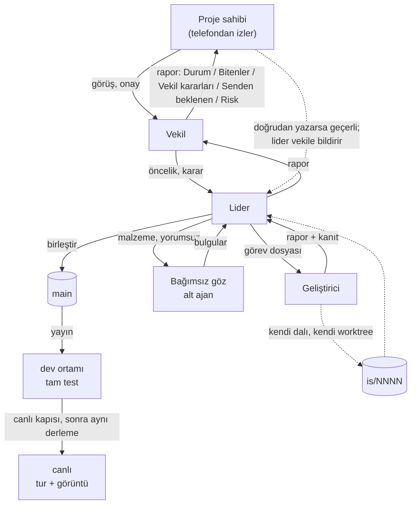

# VekilEkip: çok oturumlu Claude Code çalışma yöntemi

[English](GUIDE.en.md) · Türkçe

VekilEkip, bir yazılım projesini üç Claude Code oturumuyla yürütmek için bir yöntem ve küçük bir araç kitidir.
Proje sahibi yalnız bir oturumla, **vekil** ile konuşur. Vekil rutin kararları onun yerine verir ve **lider**e iletir.
Lider işi böler, inceler, birleştirir ve yayımlar. **Geliştirici** yalnız kod yazar. Bütün oturumların ortak belleği
git deposudur; sohbet geçmişine güvenilmez. Amaç: proje sahibinin tıkaç olmaması, kararların kaybolmaması, oturumların
kayıpsız durup devam etmesi ve "bitti" denen işin kanıtıyla bitmiş olması.

Hızlı kurulum için: [HIZLI-BASLANGIC.md](HIZLI-BASLANGIC.md). English: [GUIDE.en.md](GUIDE.en.md). Doldurulmuş bir örnek: [ornek/](ornek/).

> **Durum: deneysel.** Bu kit bir deneyim paylaşımıdır: iki projede, tek kişi tarafından, birkaç gün kullanıldı.
> Aşağıdaki faydalar hedeftir, henüz ölçülmüş sonuç değildir. Kit, maliyeti ve kazancı ölçmeye yarayacak kayıtları artık
> kendisi tutuyor. İlk ölçüm girişi 4 Aralık 2026 Cuma günü, sonraki üçü izleyen üç cuma yayımlanır: [OLCUM-GUNLUGU.md](OLCUM-GUNLUGU.md). Parçaların çoğu (lider ve işçi oturumlar, worktree,
> ayrı gözden geçirici, devir notu) bilinen yöntemlerdir; bu kit onları bir araya getirir ve üstüne birkaç kural koyar.
> Kurallardan biri yaşanmış bir olaydan çıktı; öbürleri öngörülen risklere karşı yazıldı.

---

## Bu kitin katkısı

**Özgün olan (bulabildiğimiz kadarıyla):** vekil. Lider ve geliştirici oturumlarından oluşan düzenler biliniyor; onlarda insan doğrudan
liderle konuşur ve her karar yine insana gelir. Burada araya, proje sahibinin yerine rutin kararları veren ayrı bir oturum girer.
Neye karar verebileceği yazılıdır, verdiği her karar kayda geçer, sınırın ötesindeki her şey proje sahibine gider.
Benzerleri ve farklar için: [Benzer çalışmalar ve bu kitin yeri](#benzer-çalışmalar-ve-bu-kitin-yeri).

**Fark ettirmek istediği dört şey:**

1. **Darboğaz çoğu zaman model değil, insandır.** Her küçük karar insana geldiğinde iş onun hızında ilerler. Soru "model ne kadar hızlı" değil, "hangi karar gerçekten benim" olmalıdır.
2. **İnsanın sözü de bir iddiadır.** Proje sahibinin "girdim" demesi, kayıtla doğrulanmadan doğru sayıldı ve yanlış çıktı. Doğrulama yalnız modelin söylediklerine değil, zincirdeki herkese uygulanır.
3. **İşi yapan, kendi işini iyimser anlatır.** Bu yüzden kanıt istenir ve kabulden önce sonucu bilmeyen bir göz bakar. O göz de aynı modeldir; kör noktayı azaltır, kaldırmaz.
4. **Ölçmeden iddia etmek kolaydır.** Bu kit de "hızlandırdı" diyerek başladı; geriye dönük ölçmeye çalışınca sayıların tanımlara ne kadar bağlı olduğu görüldü ve iddia geri çekildi. Yerine bir [ölçüm günlüğü](OLCUM-GUNLUGU.md) kondu.

---

## İçindekiler

1. 5N1K (Ne, Neden, Kim, Nerede, Ne zaman, Nasıl)
2. Hedeflenen fayda
3. Gereklilik ve maliyet
4. Kurallar ve dersler
5. Tek hesap mı, çok hesap mı
6. Sık hatalar
7. Sınırlar
8. Önerilen eklemeler
9. Benzer çalışmalar ve bu kitin yeri
10. Kitin içeriği

---

## 5N1K

### Ne?

Üç rollü bir Claude Code düzeni ve onu ayakta tutan birkaç kural:

- **Tek hat.** Proje sahibi → vekil → lider → geliştirici. Her mesaj bu hattan geçer.
- **Vekil yetkisi.** Rutin kararlar vekilde; para, sır, veri silme gibi kararlar proje sahibinde.
- **Canlı kapısı.** Canlıya kimin çıkacağı proje başına ayarlanır: proje sahibi ya da vekil.
- **Ortak bellek depodur.** Durum, kararlar ve görevler depodaki dosyalarda durur.
- **Bağlam temizliği.** Büyük iş bitince devir notu, commit, `/clear`.
- **Mola protokolü.** "Mola ver" denince bütün oturumlar işini kayıpsız toparlayıp durur; hedef yaklaşık 5 dakikadır (süre ölçülmedi). Bir betik durumu denetler.
- **Bağımsız göz.** Kabulden önce yorumsuz bir alt ajan malzemeye bakar.
- **Doğrulama.** Kanıtsız "çalıştı" yok.

### Neden?

| Sorun | Belirtisi | VekilEkip'teki karşılığı |
|---|---|---|
| Proje sahibi tıkaç | Her küçük soru ona gelir; o yokken iş durur. | Vekil rutin kararları verir, kayda yazar. Proje sahibine yalnız gerçekten onun kararı olanlar gider. |
| Bağlam ve karar kaybı | Oturum kapanınca ya da bağlam dolunca "neden böyle yaptık" unutulur. | Durum, devir notu ve kararlar depoda. Yeni oturum oradan başlar. |
| Tekrar tartışılan kararlar | Aynı soru haftada üç kez açılır. | Numaralı karar kaydı. Verilmiş karar yeniden açılmaz; değişecekse yeni kayıt yazılır. |
| Yanılgı ve iyimser rapor | "Çalıştı" denir, çalışmamıştır. Model kendi işini iyi görür. | Kanıt kuralı ve bağımsız göz. Sonuç görüntüde ne görünüyorsa o yazılır. |
| Çerçeve kayması | Küçük bir iş büyür, sırada bekleyenleri yutar. | Lider işi görev dosyasına böler; kapsam dışı yazılır. Vekil öncelik verir. |
| Kota israfı | Her oturum aynı dosyaları okur; bağlam şişer. | Geliştirici yalnız kod yazar; inceleme liderin alt ajanlarında. Düzenli bağlam temizliği. |
| Hareket halindeyken güvenli durma | Proje sahibi telefondan "dur" demek ister; yarım iş kaybolur. | Mola protokolü ve denetim betiği. Yayın yarıda kesilmez. |

### Kim?

| Rol | Ne yapar | Neye karar verir | Kime yazar |
|---|---|---|---|
| **Proje sahibi** (insan) | Yön verir, sonucu görür. | Para, sır, veri silme, dışarı gönderme, geri dönüşü zor karar, duyuru ve erişim açma, hukuki metin, son görsel ve tasarım onayı, elle indirilecek bağlantı. Canlıya çıkış (projede yetki vekile devredilmediyse). | Yalnız vekile. |
| **Vekil** (oturum) | Proje sahibinin görüşünü alır, rapor verir, iddiaları doğrulatır. Kod yazmaz; yalnız kendi raporunu ve karar kayıtlarını yazar. | İş sırası ve öncelik; teknik yöntem; ücretsiz ve açık lisanslı araç ya da varlık denemek; dev ortamına yayın; önceki ölçütlere dayanan geri alınabilir tasarım ayrıntısı. Canlıya çıkış, proje başına ayarlanır (aşağıda "Canlıya çıkış yetkisi"). Her biri "vekil kararı" diye kaydedilir. | Yalnız lidere. |
| **Lider** (oturum) | İşi böler, görev yazar, inceler, birleştirir, yayımlar, yayın sonrası tur atar, bağımsız gözü çalıştırır. Kod yazmaz; durum dosyasını ve görev dosyalarını yazar. | Görevin nasıl bölüneceği, incelemenin sonucu, birleştirme. | Geliştiriciye görev; vekile rapor. |
| **Geliştirici** (oturum) | Yalnız kod yazar; kendi dalında, kendi worktree'sinde. | Görev içindeki uygulama ayrıntısı. | Lidere rapor. |

İki istisna:
- Proje sahibi bir oturuma doğrudan yazarsa o geçerlidir. Geliştiriciye yazdıysa geliştirici lidere bildirir; lider de vekile bildirir. Böylece vekilin resmi eksik kalmaz.
- Proje sahibi üç oturumu da izleyebilir (aşağıda "Proje sahibi izleme").

### Nerede?

| Bilgi | Yer | Depoya girer mi |
|---|---|---|
| Güncel durum, liderin devir notu (yalnız lider yazar) | `docs/DURUM.md` | Evet |
| Kararlar | `docs/kararlar/NNNN-ad.md` | Evet |
| Görev, rapor, inceleme, geliştiricinin devir notu | `docs/gorevler/NNNN-ad.md` | Evet |
| Olaylar ve dersler | `docs/olaylar.md` | Evet |
| Rol istemleri, bağımsız göz istemi | `docs/ekip/` | Evet |
| Ekip kuralları (her oturum okur) | `CLAUDE.md` içinde "Ekip ve hat" bölümü | Evet |
| Vekilin proje sahibine raporu ve devir notu | `yerel/vekil/rapor.md` | Hayır |
| Mola kaydı | `yerel/mola.json` | Hayır |
| Yayın kilidi | `yerel/yayin.kilit` | Hayır |
| Canlı onayı | `yerel/canli-onay.json` | Hayır |
| Sırlar | Depo dışında ya da `yerel/` altında; yalnız araçlar okur | Asla |
| Oturum hafızası, sohbet geçmişi | Claude Code'un kendi klasörü | — |

**Oturum hafızasına neden güvenilmez?** Üç nedeni var:
1. Her oturumun belleği ayrıdır. Öbür oturum onu göremez.
2. Bağlam dolunca ya da `/clear` sonrası içerik özetlenir ya da silinir. Özet ayrıntıyı kaybeder.
3. Hafıza denetlenemez. Depodaki bir dosya ise okunur, karşılaştırılır, geçmişi vardır.

Kural basittir: öbür oturumun bilmesi gereken her şey depoya yazılır.

`yerel/` klasörü bu kuralın istisnası değildir: orada yalnız o makineye ait, geçici şeyler durur (mola kaydı, kilit, canlı onayı, vekilin proje sahibine raporu). Kalıcı olması gereken her şey, örneğin vekilin verdiği kararlar, depodaki `docs/kararlar/` altına yazılır.

### Ne zaman?

| Değer | Proje türü |
|---|---|
| **Gereksiz** | Tek dosyalık betik; bir saatlik deneme; tek kişinin tek oturumda bitireceği iş. Bu işlerde düzenin yükü kazancından büyüktür. |
| **Belki** | Birkaç saatlik, tek parçalı iş. Yalnız ortak bellek kuralı (DURUM.md, karar kaydı) bile yeter. |
| **Değerli** | Birkaç gün ya da hafta süren, çok parçalı, yayını olan proje. Proje sahibinin her an başında olamadığı iş. Görsel ya da tasarım kabulü gereken iş. |

İşaret: "Dün neye karar vermiştik?" sorusu sorulmaya başladıysa ya da proje sahibi telefondan yönetmek istiyorsa
bu düzen işe yarar.

### Nasıl?

#### Akış



Düz metin hali:

```
Proje sahibi ──görüş──▶ Vekil ──öncelik──▶ Lider ──görev──▶ Geliştirici
     ▲                    │  ▲                │  ▲                 │
     └──────rapor─────────┘  └─────rapor──────┘  └──rapor+kanıt────┘
                                              │
                         bağımsız göz (alt ajan) ◀── malzeme
                                              │
                       main ──▶ dev (tam test) ──canlı kapısı──▶ canlı (tur, görüntü)
```

#### Mesaj hattı

- Mesajla yalnız görev ve kısa durum gider. İçerik dosyaya yazılır, mesajda dosyanın yolu verilir.
- Örnek: lider geliştiriciye "Görev 0012: `docs/gorevler/0012-giris-formu.md` dosyasını oku." yazar.
  Geliştirici bitince raporu aynı dosyanın "Rapor" bölümüne yazar ve lidere tek satır gönderir.
- Vekil geliştiriciye yazmaz. Geliştirici vekile yazmaz. Bu, aynı konuda iki ayrı talimatın çıkmasını önler.

#### Günlük ritim

| Zaman | Ne olur |
|---|---|
| Başlangıç | Her oturum `git log -5`, `docs/DURUM.md`, kendi devir notu (geliştirici: görev dosyası; vekil: `yerel/vekil/rapor.md`) ve ilgili kararı okur. Rol istemi `docs/ekip/ilk-mesajlar.md` dosyasından yapıştırılır. |
| Gün içinde | Proje sahibi vekile yazar. Vekil karar verir ya da proje sahibine sorar, lidere iletir. Lider görev açar, geliştirici kodlar, lider inceler ve birleştirir. |
| Büyük iş bitince | Devir notu, commit, `/clear`. |
| Yayından sonra | Lider gerçek ortamda tur atar, görüntü alır, bağımsız göze verir, vekile raporlar. |
| Gün sonu ya da uzun ara | Mola protokolü ya da bağlam temizliği. Vekil son raporu yazar. |
| Haftada bir | Kısa geriye bakış (`docs/ekip/geriye-bakis.md`). |

#### Bağlam temizliği

Ne zaman: her büyük görev bitince ya da bir saatten uzun aradan önce.

1. Oturum kendi **devir notu**nu günceller: ne yapılıyordu, yarım dosyalar, denenip işe yaramayan, sıradaki somut adım. Her dosyanın, görev dosyasında ise her bölümün tek yazarı vardır: lider `docs/DURUM.md`, geliştirici kendi görev dosyasındaki "Devir notu" bölümü, vekil `yerel/vekil/rapor.md`.
2. Depodaki dosyayı commit eder (vekilin raporu depoya girmez, commit edilmez). Yarım iş varsa mesajda "yarım" yazar.
3. `/clear`.
4. Rol istemi yapıştırılır. Oturum `git log -5`, `DURUM.md`, kendi devir notu ve ilgili kararla başlar.

Neden: uzun bağlam her adımda yeniden okunur ve kotayı yer. Beklenti, temiz başlayan oturumun depodaki özetle daha isabetli çalışmasıdır; bu ölçülmedi, tek kullanıcının gözlemidir.

#### Mola

"Mola ver" denince bütün oturumların yaklaşık 5 dakikada kayıpsız durması hedeflenir (süre ölçülmedi; iki projedeki gözlemdir).

1. Proje sahibi vekile "Mola ver." yazar.
2. Vekil lidere iletir; lider geliştiriciye.
3. Her oturum işini durdurur: çalışan testi ve sunucuyu kapatır, kendi devir notunu yazar, yarım işi "yarım: ..." diye commit eder.
4. Lider `node araclar/mola.mjs` çalıştırır.
5. Çıkış 0 ise vekile "güvende" ve tek satır durum yazar. Vekil proje sahibine iletir.
6. Çıkış 1 ise betik neyin durması gerektiğini satır satır yazar; lider onları kapatıp yeniden dener.

**Yayın yarıda kesilmez.** Ya bitirilir ya önceki sürüme dönülür. Betik yayın kilidini görürse molayı geciktirir.

"Mola bitti" denince lider `node araclar/mola.mjs bitti` çalıştırır. Betik, kopyaların molaya girerken kaydedilen
commit'te olup olmadığına bakar. Herkes kendi devir notundan devam eder.

Betik ne denetler:

| Denetim | Sonuç |
|---|---|
| Her worktree temiz mi | Kirliyse **engel** |
| Ayarda tanımlı süreçler (test, geliştirme sunucusu, Blender gibi) bir çalışma kopyasının içinde çalışıyor mu | Çalışıyorsa **engel** |
| Yayın kilidi var mı | Varsa **engel** |
| Devir notu (`docs/DURUM.md`) son 30 dakikada commit edildi mi | Edilmediyse **uyarı** (`devirNotu.engel: true` ile engel yapılabilir) |
| Rafa kaldırılmış iş (`git stash`) var mı | Varsa **uyarı** (mola onu görmez) |
| Uzak depoya gönderilmemiş commit var mı | **Uyarı** (yerel commit kayıp değildir) |
| Worktree içinde tanınmayan süreç var mı | **Bilgi** |

Betik hiçbir süreci öldürmez. Yalnız denetler ve durumu `yerel/mola.json` dosyasına yazar. Yalnız sizin kullanıcınızın süreçlerine bakar.
Çıkış kodları: 0 güvenli, 1 değil, 2 kullanım ya da ayar hatası.

Ayarlar (`.vekilekip.json`; verilen alan varsayılanın yerine geçer):

| Alan | Ne | Varsayılan |
|---|---|---|
| `uzak` | Gönderim denetiminde bakılan uzak depo | `origin` |
| `surecler` | Engel sayılan süreç kalıpları: `ad`, `kalip` (düzenli ifade), `kapsam`. `kapsam: "kopya"` yalnız bir çalışma kopyasının içinde çalışan süreci sayar; `"her-yer"` nerede çalışırsa çalışsın sayar. | tarayıcı testi, test izleyici, geliştirme sunucusu, Blender |
| `yoksay` | Hiç bakılmayan süreç kalıpları | kabuk, git, claude, düzenleyiciler |
| `bilgiKapilari` | Bu kapıları dinleyen süreç grubu engel değil bilgi sayılır (ör. sizin açık bıraktığınız geliştirme sunucusu) | boş |
| `bilinmeyenleriYaz` | Kopya içinde çalışan, tanınmayan süreçleri bilgi olarak yaz | `true` |
| `devirNotu` | `dosya`, `dakika`, `engel`. Dosya son `dakika` içinde commit edilmediyse uyarı; `engel: true` ise mola engellenir. | `docs/DURUM.md`, 30, `false` |
| `canli` | Canlı kapısı: `yetki` (`sahip` ya da `vekil`), `dal`, `onay` (onay dosyasının yolu), `gecerlilikSaat`, `mesajlaOnay` (onay kancası kuruluysa mesajla onaya izin verir) | `sahip`, `main`, `yerel/canli-onay.json`, 24, `false` |
| `kayit`, `kilit` | Mola kaydının ve yayın kilidinin yolu | `yerel/mola.json`, `yerel/yayin.kilit` |

Komutlar: `node araclar/mola.mjs` (mola), `node araclar/mola.mjs bitti`; `node araclar/canli.mjs durum | onayla [commit] | denetle [commit] | kullan`.
İkisi de `--kok <depo>` ve `--ayar <dosya>` seçeneklerini alır.

#### Yayın ve ortamlar

- `main`e giren iş önce **dev** ortamına gider. Tam testler orada koşar.
- Testler geçerse **canlı kapısı** denetlenir (aşağıda "Canlıya çıkış yetkisi"). Kapı geçilirse **aynı derleme** canlıya yükseltilir; yeniden derlenmez. Böylece test edilen ile yayımlanan aynıdır.
- İki ortamda da **sürüm rozeti** görünür (commit kimliği ve ortam adı). Bu, "hangi ortamdayım" sorusunu görüntüyle yanıtlar.
- **Yayın denenmeden bitmez.** Yayından sonra lider gerçek ortamda tur atar, görüntü alır, bağımsız göze verir.
  Raporda "üründe olan" ile "henüz olmayan" ayrı yazılır.
- Yayın betiği bir kilit dosyası yazar; mola denetimi onu görür. Kilit ve canlı kapısı adımlarının örneği: `sablonlar/ornekler/yayin-kilidi.sh`.

#### Canlıya çıkış yetkisi

Bazı projelerde canlıya vekil çıkabilir, bazılarında mutlaka insan çıkar. Bu, proje başına bir ayardır
(`.vekilekip.json` → `canli.yetki`); `kur.sh` kurulumda sorar, varsayılan "sahip"tir. Canlıya çıkan dal `canli.dal` ile belirlenir (varsayılan `main`).

| Ayar | Kim karar verir | Nasıl işler |
|---|---|---|
| `"sahip"` | Proje sahibi | Proje sahibi **kendi terminalinde** `node araclar/canli.mjs onayla` çalıştırır ve commit'in kısa kimliğini yazar. Onay o commit'e bağlıdır ve 24 saat geçerlidir. Lider (ya da yayın betiği) canlıya yükseltmeden hemen önce `node araclar/canli.mjs denetle <yayımlanacak commit>` çalıştırır; onay yoksa, eskiyse ya da başka bir commit içinse çıkış 1 verir ve canlıya çıkılmaz. Commit verilmezse canlı dalının ucu denetlenir; derlemeden sonra dal ilerlemiş olabileceği için yayımlanan derlemenin commit'ini açıkça verin. Yayın bitince `node araclar/canli.mjs kullan` onayı siler; böylece aynı onay ikinci bir yayında geçmez. |
| `"vekil"` | Vekil | `denetle` onay aramaz. Vekil her canlıya çıkışı "vekil kararı" olarak karar kaydına yazar ve raporda bildirir. Geri alması kolay, riski düşük projeler içindir. |

Koruma iki katmandır ve ikisi birlikte kullanılmalıdır:

1. `onayla` etkileşimli terminal ister. Oturumların araç çağrıları etkileşimli değildir; bu yüzden bir oturum bu komutla onay veremez.
2. Rol kancası (`sablonlar/ornekler/kanca-rol.mjs`) onay dosyasına araçla yazmayı, `onayla` çağrısını ve onay dosyasının adını anan kabuk komutlarını durdurur. Kanca kalıpla tanır; dosya adını anmadan, dolaylı yoldan yazan bir komutu yakalayamaz. Bu kanca kendiliğinden kurulmaz. **Kanca kurulu değilse bir oturum onay dosyasını elle yazabilir**; "sahip" ayarına güvenecekseniz kancayı kurun.

Bu bir kapıdır, kasa değildir: kurala uyan bir oturumu yanlışlıkla canlıya çıkmaktan korur; kuralı bilerek aşmaya çalışan bir komutu her zaman durduramaz.
Telefondan çalışırken: Remote Control ile vekil oturumuna her zamanki gibi yazarsınız; kısıt yalnız onayın kendisindedir. Onayı model yazamaz; yazabilseydi sizin onayınızı vekilin kendi kararından ayıran bir şey kalmazdı. Üç yol vardır:

| Yol | Telefondan ne yaparsınız | Koruma |
|---|---|---|
| SSH ile onay | Telefondan bilgisayarınıza SSH ile bağlanıp `node araclar/canli.mjs onayla` çalıştırırsınız. | En güçlü. Ek ayar gerekmez. |
| Mesajla onay | Bir oturuma, mesajın tamamı olarak `canlı onay <kısa kimlik>` yazarsınız. Onay dosyasını model değil, mesajınızı gören onay kancası yazar (`sablonlar/ornekler/kanca-onay.mjs`). `canli.mesajlaOnay: true` ve kancanın kurulu olması gerekir. | Orta. Oturumu açabilen herkes bu cümleyi yazabilir. **Canlı oturumda denenmedi:** kancanın Remote Control mesajlarında çalıştığını ve öbür oturumlardan gelen mesajları onay saymadığını kendi kurulumunuzda deneyin (adımlar betiğin başında). |
| Yetkiyi vekile vermek | O projede `canli.yetki: "vekil"`. Vekile "canlıya çık" yazarsınız; mesajınız karar kaydına geçer. | Kurala dayanır: vekilin siz yazmadan çıkmasını engelleyen bir mekanizma yoktur. |

#### Bağımsız göz

Ne zaman: görsel ya da tasarım kabulünden önce, bir işe "bitti" denmeden önce, yayından sonraki turda.

Nasıl:
1. Lider yeni bağlamlı bir alt ajan açar.
2. Yalnız malzemeyi verir: görüntüler, ölçütler, ölçümler, raporda yazan cümle. A/B karşılaştırmasında adlar rastgele harftir; hangisinin yeni olduğu söylenmez.
3. Kendi sonucunu, beklentisini ya da gerekçesini **vermez**.
4. Üç temel soru sorar:
   - Kaynakla tercih karışmış mı? (Bir tercih "kaynak böyle diyor" diye mi sunulmuş?)
   - Çözüm yerel mi, genel mi? (Yalnız bu örneği mi düzeltiyor?)
   - Anlatılan sonuç görüntüyle uyuşuyor mu?

   Şablonda iki soru daha vardır: A/B karşılaştırmasında hangisinin daha iyi olduğu ve görüntüde bariz bir kusur olup olmadığı.
5. Yanıtı kendi sonucuyla karşılaştırır, farkı görev dosyasına yazar. Fark varsa vekile götürür.

İstem şablonu: kitte `sablonlar/bagimsiz-goz.md`, kurulu projede `docs/ekip/bagimsiz-goz.md`.

Önce kesin denetim: testle, betikle ya da ölçümle doğrulanabilen şey öyle doğrulanır; göz ölçülemeyene bakar. Her turda yeni bir
alt ajan açılır. Canlıya çıkış ve geri dönüşü zor kararda göz mümkünse farklı bir modelle çalıştırılır.

Neden: işi yapan, kendi işinin kusurunu görmekte zorlanır. Sonucu bilen bir gözden geçirici de onu onaylamaya eğilimlidir.
Malzemeyi alan ama sonucu bilmeyen göz bu iki tuzağa daha az düşer. Modelin kendi kör noktası ise kalır (bkz. "Sınırlar").

#### Ölçüm

`araclar/olcum.py` oturum kayıtlarından ve git geçmişinden yalnız sayı çıkarır: proje sahibinin mesaj sayısı ve tahmini etkin süresi,
her rolün tahmini etkin süresi, oturumlar arası mesajlar, karar sayıları, alt ajan çağrıları, commit'ler ve rol başına token (girdi, çıktı, önbellek).
"zaman" bölümü şunları verir (dakika): takvim süresi, proje sahibinin etkin süresi, ekibin etkin süresi (en az bir oturumun
çalıştığı süre), proje sahibi yokken ekibin çalıştığı süre ve ekibin boşta kaldığı sürenin dağılımı (60 dakikaya kadar, 1-3 saat, 3 saatten uzun boşluklar). Mesaj metni,
ad ya da dosya içeriği çıktıya girmez; proje bir kod adıyla anılır.

```bash
python3 -I araclar/olcum.py --kod ATLAS --bas 2026-01-05T00:00:00+03:00 --depo . \
    vekil=<vekil oturum kaydı>.jsonl lider=<lider oturum kaydı>.jsonl gelistirici=<geliştirici oturum kaydı>.jsonl
```

Oturum kayıtları Claude Code'un yapılandırma klasöründe, `projects/` altında durur. Birden çok projenin çıktısını birleştirmek için her birini `--json` ile alın, sonra `python3 -I araclar/olcum.py birlestir a.json b.json`.

Sınırlar:
- Etkin süreler tahmindir. Proje sahibi için mesajlar arasındaki 20 dakikadan kısa aralar çalışma sayılır; yapıştırılan rol istemleri sayılmaz. Oturumlar için kayıttaki mesaj ve yanıtlar arasındaki 10 dakikadan kısa aralar çalışma sayılır; ayrıca bir araç çağrısının başından sonucuna kadar geçen süre, ne kadar uzun olursa olsun çalışma sayılır (uzun derleme, test). Oturumun proje sahibine soru sorup yanıt beklediği süre ve oturumun yalnızca açık durması çalışma sayılmaz.
- Telefondan yalnız okunan süre ölçülmez; yalnız yazılan mesajlar sayılır.
- Alt ajan kayıtları da verilmelidir (oturum klasöründe `subagents/` altında); verilmezse ekibin etkin süresi ve token toplamı eksik çıkar. İçlerindeki görev metinleri proje sahibinin mesajı sayılmaz.
- Birkaç sayı kalıba dayanır; kalıp kullanılmadıysa hata vermez, 0 çıkar. Roller, oturum adında "vekil", "lider" ya da "gelistirici" geçmesiyle tanınır (rol adlarını değiştirdiyseniz "diger" sayılır). Kararlar "Vekil kararı" ve "Lider kararı" sözleriyle, birleştirmeler konusu "Birleştirme" ile başlayan commit'lerle, canlıya çıkışlar konusunda "canlıya yükseltme" geçen commit'lerle sayılır. Tam liste betiğin başındaki açıklamadadır.
- Oturum çalışırken gelen mesajlar kayda farklı biçimde düşer; araç onları da sayar. İznini proje sahibinin verdiği araç çağrılarının süresi çalışma sayılmaz, `izin_bekleme_dakika` diye ayrı yazılır: o sürenin içinde hem bekleme hem aracın çalışması vardır ve kayıttan ayrılamaz. İzin bilgisi tutmayan eski kayıtlarda bu ayrım yapılamaz. Rapor etiketleri büyük harfle yazılmışsa sayılır.
- Ücret hesaplanmaz, yalnız token sayılır.

#### Proje sahibi izleme

Proje sahibi üç oturumu Claude Code'un **Remote Control** özelliğiyle telefondan izler. Görüşünü yalnız vekil
oturumuna yazar. Böylece hareket halindeyken de yön verebilir, mola diyebilir, raporu okuyabilir.
Yetki proje sahibindeyse canlı onayı Remote Control üzerinden, yani bir oturuma yazarak verilemez; bilgisayardaki bir terminalde verilir (bkz. "Canlıya çıkış yetkisi").

Rapor biçimi (telefonda iki dakikada okunur):

```
Durum: tek satır
Bitenler: madde madde, her birinin yanında görüntü ya da kayıt
Vekil kararları: karar + tek satır gerekçe + kayıt yolu
Senden beklenen: yalnız proje sahibinin verebileceği karar ya da iş
Risk: varsa
```

---

## Hedeflenen fayda

Bunlar yöntemin amaçladığı sonuçlardır; ölçülmüş sonuç değildir.

**Gözlem (proje sahibinin gözlemi, ölçüm değil):** iki projede kesintiler azaldı, kararlar kayda geçti, işler daha düzenli ve daha hızlı ilerledi; çerçeve kayması ya da baştan yazma olmadı.

**Maliyet:** tek oturuma göre toplam token harcamasının fazla mı, az mı olduğu henüz ölçülmedi. Bir yanda üç oturum ve alt ajanlar çalışır; öbür yanda her oturumun bağlamı küçük kalır ve sık temizlenir (lider ve geliştirici sık, vekil daha seyrek; hangisinin ne zaman temizleneceğine işin durumuna göre vekille birlikte karar verilir). Hangi etkinin ağır bastığı, karşılaştırmalı ölçümle anlaşılacak.

**Ölçüm:** Yöntem kurulurken ölçmek akılda yoktu; kayıtlardan geriye dönük ölçme denemeleri, zamana dayalı ölçülerin tanımlara ne kadar bağlı olduğunu gösterdi. Bu yüzden kit artık ölçüme yarayacak kaydı baştan tutuyor: her görev dosyasının sonunda kısa bir "Ölçüm" bölümü (süre, tur sayısı, yakalanan hata ve aşaması, proje sahibine gidilen kararlar) ve oturum kayıtlarından token, mesaj ve etkin süre çıkaran `araclar/olcum.py`. Asıl soru şu: bu yöntem, tek oturumla çalışan bir insana göre neye mal oluyor ve ne kazandırıyor? Yanıtı [OLCUM-GUNLUGU.md](OLCUM-GUNLUGU.md) sayfasında birikir: ilk giriş 4 Aralık 2026 Cuma, sonraki üçü izleyen üç cuma (11, 18 ve 25 Aralık). Ölçüm yaklaşık bir ay sürer; son girişte sonuç özetlenir.

- **Proje sahibi tıkaç olmaz.** Rutin kararlar vekilde. Proje sahibi yokken iş sürer; döndüğünde iki dakikalık raporu okur.
- **Kararlar kaybolmaz.** Numaralı kayıtlar sayesinde "neden böyle yaptık" sorusunun yanıtı bir dosyadadır.
- **Kararlar yeniden tartışılmaz.** Değişiklik yeni kayıtla yapılır; eski kayıt gerekçesiyle durur.
- **Oturum değişimi ucuzdur.** Kota dolan ya da bağlamı şişen oturum temizlenir; yeni oturum devir notundan beş dakikada işe döner.
- **Raporlar denetlenebilir.** Her iddianın yanında kanıt durur; bağımsız göz iyimser anlatıyı yakalamayı hedefler. Hepsini yakalamaz: denenen projelerden birinde iki küçük sorun canlıya kaçtı.
- **Paralel çalışma güvenlidir.** Geliştirici kendi worktree'sinde çalışır; ana kopyayı bozmaz.
- **Güvenli durma.** "Mola ver" ile beş dakikada her şey commit edilmiş, süreçler kapanmış olur; betik bunu doğrular.
- **Kota bilinçli harcanır.** Pahalı inceleme tek yerde (liderin alt ajanları), tam test tek sefer, bağlamlar sık temizlenir. Toplam harcamanın tek oturuma göre nasıl olduğu henüz karşılaştırılmadı; `araclar/olcum.py` rol başına token sayar.
- **Telefondan yönetim.** Proje sahibi tek oturuma yazarak bütün ekibi yönetir.
- **Yeni başlayan kolay katılır.** Bütün bağlam depoda; okuyarak öğrenilir.

---

## Gereklilik ve maliyet

| Kalem | Ne kadar | Not |
|---|---|---|
| **Kota** | Tek oturumla karşılaştırması henüz ölçülmedi. | Üç oturum ve alt ajanlar harcamayı artırır; sık bağlam temizliği ve "geliştirici yalnız kod yazar" kuralı azaltır. Net sonuç bilinmiyor; `araclar/olcum.py` ile ölçülebilir. Tek hesapta üç oturum aynı kotadan yer. |
| **Kurulum** | 10–15 dakika. | `kur.sh` dosyaları kurar; çok hesap için takma adlar ve hesap girişi gerekir. |
| **Disiplin** | Sürekli. | Devir notu yazmak, karar kaydı tutmak, hattı bozmamak. Kural çiğnenince düzenin faydası hızla düşer. |
| **Araç** | git, Node.js 18 ve üstü, bash; ölçüm için Python 3. | Araçlar ek paket istemez. Mola denetimi `ps` ve `lsof` kullanır; macOS'ta ikisi de kuruludur, Linux'ta `lsof` yoksa yalnız "bilgi kapıları" özelliği çalışmaz. |
| **İşletim sistemi** | macOS ve Linux. | macOS'ta geliştirildi; Ubuntu 24.04'te testler, kurulum ve mola denetimi denendi. Windows'ta WSL (Ubuntu) önerilir. Yerel Windows için mola denetiminde PowerShell yolu vardır ama **denenmedi**; `kur.sh` Git Bash ister. |
| **Öğrenme** | Tek kullanıcının deneyimiyle bir iki gün. | İlk günlerde kurallar ağır gelir; haftalık geriye bakışla gereksizleri ayıklayın. |

Kural ekleme ölçütü (bundan sonrası için): yeni bir kural ancak **gerçek bir olaydan** sonra ya da aynı işin **üçüncü elle tekrarında** eklenir.
Kitin başlangıç kuralları bu ölçütten önce yazıldı; aşağıda hangisinin olaydan, hangisinin öngörüden geldiği belirtilir.
Mümkünse çalışan bir denetim (betik) olarak; değilse tek satır olarak. Uzun yönerge metni eklenmez.

---

## Kurallar ve dersler

Her kuralın bir nedeni var. İlki yaşanmış bir olaydır; öbürleri kuralın önlediği riski anlatır.

**"Girdim" sözü doğrulanmadan aktarılmaz.** *(yaşanmış olay)*
Proje sahibi "girdim" dedi; vekil bunu kayda bakmadan "giriş doğrulandı" diye aktardı. Sonra yanlış ortama
girildiği anlaşıldı. Ders: insan sözü de bir iddiadır. Vekil, hangi ortam ve hangi sürüm olduğunu kayıtla
(sunucu kaydı, sürüm rozeti görüntüsü) doğrulatır.

**Bir derece bile iyimser anlatılmaz.**
Model kendi işini olduğundan iyi anlatmaya eğilimlidir: "büyük ölçüde düzeldi" der, görüntüde sorun sürer.
Kural: sonuç görüntüde ne görünüyorsa o yazılır. "Düzeldi" değil, "şu üç yerde düzeldi, şu yerde sürüyor".

**Yayın yarıda kesilmez.**
Yarıda kalan yayın, ortamı ne eski ne yeni sürümde bırakır. Kural: mola yayını bekler; kilit dosyası bunu sağlar.

**Sır yalnız araçla okunur.**
`cat` ile yazdırılan bir anahtar sohbet geçmişine düşer ve yenilenmesi gerekir. Kural: sırrı yalnız onu kullanan
araç okur. Oturum yalnız `wc -c` ya da `test -s` ile var olup olmadığına bakar. Sır kullanıcıdan `read -s` ile alınır.
Sızıntı olursa hemen bildirilir, sır yenilenir, olay günlüğüne yazılır.

**Kendi işini kendin onaylamazsın.**
Öneriyi yazan oturum kendi kör noktasını göremez. Kural: geri dönüşü zor kararda ve görsel kabulde bağımsız göz şarttır.

**Hat bozulmaz.**
İki oturum aynı geliştiriciye farklı talimat verirse geliştirici ikisini birden yapmaya çalışır. Kural: tek hat.

**Tam test bir kez.**
Her dalda tam test koşmak kotayı ve zamanı yer; birleştirmeden sonra yine koşmak gerekir. Kural: dalda birim
testleri, tam test birleştirmeden sonra bir kez.

Kendi olaylarınızı `docs/olaylar.md` dosyasına yazın; yeni kurallar oradan doğar.

---

## Tek hesap mı, çok hesap mı

| | Tek hesap | Çok hesap |
|---|---|---|
| **Kurulum** | Kolay: üç terminal sekmesi, `/rename`. | Her hesap için ayrı yapılandırma klasörü ve takma ad (`claude-ali` → `~/.claude`, `claude-veli` → `~/.claude-k2`). |
| **Kota** | Üç oturum tek hesabın kotasından yer. | Her oturum kendi hesabının kotasından yer; örneğin geliştirici ikinci hesapta. |
| **Oturumların birbirini görmesi** | Doğal: aynı hesap (gerçek kurulumda doğrulandı). | Görmez. İsteğe bağlı `oturum-bagla.sh` ile bağlanır; belgelenmemiş iç yapıya dayanır. |
| **Remote Control** | Tek uygulama ya da tarayıcı yeter. | Her hesap yalnız kendi oturumlarını gösterir; telefonda iki hesap için uygulama ve tarayıcıyı ayırın. |
| **Maliyet** | Bir abonelik. | Birden çok abonelik. |
| **Önerilen** | Başlangıç, kısa proje, tek hesabı olanlar. | Birden çok hesabı olan ve oturumlar arası mesajı elle taşımak istemeyenler. |

Önemli: proje içeriği yalnız sizin hesaplarınızda kalır. Başkasının hesabına proje içeriği göndermeyin.

Çok hesaplı düzenin amacı, zaten sahip olduğunuz hesapları farklı rollerde kullanmak ve mesajları elle taşımaktan kurtulmaktır. Kullanım sınırlarını aşmak için değildir; her hesabın kendi kullanım koşulları geçerlidir.

---

## Sık hatalar

**İki oturum aynı çalışma kopyasına yazıyor.**
Biri öbürünün değişikliğini ezer ya da yarım dosyayı commit eder. Çözüm: geliştirici her görev için ayrı worktree açar
(`git worktree add ../proje-0012 -b is/0012-ad`). Ana kopyada kod yazılmaz: lider orada birleştirir ve kendi belgelerini (durum, görev dosyaları) yazar; vekil yalnız karar kayıtlarını yazar. Yazmadan önce `git status`.

**Aynı klasörde iki test koşusu.**
İki koşu aynı derleme klasörünü ve aynı kapıları kullanır; biri öbürünün dosyalarını siler, sonuç anlamsızlaşır.
Çözüm: her koşu kendi worktree'sinde; aynı makinede ikisi birden gerekiyorsa kapılar kaydırılır.

**Sır çıktıya düşüyor.**
`cat .env`, `grep TOKEN`, hata ayıklama için `echo $ANAHTAR`. Çıktı sohbet geçmişine girer. Çözüm: yalnız `wc -c`, `test -s`.
İsterseniz örnek kancayı kurun (`sablonlar/ornekler/kanca-sir-koruma.mjs`).

**Adres tamamlamayla yanlış ortama girmek.**
Tarayıcı adres çubuğu en son girilen adresi tamamlar: canlıda denediğinizi sanırken `dev.ornek.com`'dasınız, ya da tersi.
Bir bağlantıyı açarken adresi elle yazmayın, yapıştırın ve Enter'dan önce adres çubuğuna bakın.
Çözüm: iki ortamda da sürüm rozeti; rapordaki görüntüde rozet görünsün.

**"Girdim" sözünün doğrulanmadan aktarılması.**
Bkz. "Kurallar ve dersler". Vekil, iddiayı kayıtla doğrulatmadan "çalıştı" demez.

**Devir notu yazmadan `/clear`.**
Yeni oturum nereden devam edeceğini bilmez, işi baştan keşfeder. Çözüm: `/clear` öncesi metni `docs/ekip/ilk-mesajlar.md` içinde.

**Rol istemini elle yazmak.**
Her seferinde biraz farklı yazılır; oturumlar farklı davranır. Çözüm: istemi dosyadan kopyalayın.

---

## Sınırlar

- **Remote Control yalnız onu başlatan hesabın uygulamasında görünür.** Çok hesapta telefondaki Claude uygulaması
  tek hesapla açıktır. Pratik çözüm: bir hesap uygulamada, öbürü telefonun tarayıcısında (claude.ai) açık dursun.
- **Oturum bağlama belgelenmemiş iç yapıya dayanır.** `oturum-bagla.sh`, Claude Code'un yapılandırma klasöründeki
  oturum kayıt dosyalarını hard link ile paylaştırır. Bir güncelleme bu yapıyı değiştirirse betik işe yaramaz.
  O zaman da yöntem çalışır: oturumlar arası iş zaten depodaki dosyalarla yürür; mesajı proje sahibi elle iletir.
- **`bypass` izin kipinin riskleri.** `--dangerously-skip-permissions` ile açılan oturum hiçbir araç çağrısı için izin
  istemez. Bu, üç oturumu kesintisiz çalıştırmayı kolaylaştırır ama:
  - yanlış bir komut dosya silebilir, depoyu bozabilir, uzak depoya gönderebilir;
  - sır dosyasını okuyup çıktıya düşürebilir;
  - indirilen içerikteki bir yönerge, izin sormadan uygulanabilir.

  Önlemler: her oturum kendi worktree'sinde; uzak depo yalnız sizin denetiminizdeki sunucu; düzenli commit ve yedek;
  sırlar depo dışında; örnek sır ve rol kancaları (`sablonlar/ornekler/`). Kancanın sizin izin kipinizde gerçekten çalıştığını bir kez deneyerek doğrulayın. Kipi yalnız güvendiğiniz makinede ve projede kullanın.
- **Bağımsız göz aynı modeldir.** Temiz bağlam, işi yapanın gerekçesine kapılmayı önler; modelin kendi kör noktasını önlemez. Ölçülebilen şeyi betikle ölçün; riskli kararda gözü farklı bir modelle çalıştırın.
- **Rol kuralları kanca olmadan yalnız metindir.** "Vekil kod yazmaz", "geliştirici main'e dokunmaz" gibi kuralları istem söyler; zorlayan, örnek rol kancasıdır (`sablonlar/ornekler/kanca-rol.mjs`). Kanca da kalıpla çalışır: emniyet kemeridir, kilit değildir. Kancanın mantığı testlerle doğrulandı; canlı bir oturumda uzun süre kullanılmadı.
- **Zincir uzundur.** Bilgi proje sahibinden geliştiriciye iki el değiştirir; her elde bozulabilir. Görev dosyası ve "kayıtla doğrulat" kuralı bunun içindir. Lider tek darboğazdır.
- **Ürüne bağlıdır.** Düzen, Claude Code oturumlarının birbirine mesaj atabilmesine dayanır. Bu davranış değişirse mesajı proje sahibi elle taşır; depodaki dosyalar çalışmaya devam eder. Claude Code'un kendi ekip özelliği (deneysel) benzer bir lider ve ekip üyesi düzeni sunar; ikisini karşılaştırıp size uyanı seçin.
- **Vekil yargısı insan yargısı değildir.** Vekil, ölçütleri konmuş, geri alınabilir işte iyi karar verir. Ölçütü
  olmayan ya da geri dönüşü zor işte proje sahibine sormalıdır; yetki listesi bu yüzden kısadır.
- **Mola betiği süreçleri tanımak için kalıplara dayanır.** Tanınmayan bir uzun süreç "bilgi" olarak görünür, engel
  sayılmaz. Projenize özgü süreçleri `.vekilekip.json` dosyasına ekleyin.

---

## Önerilen eklemeler

Kullanım sırasında ve kit gözden geçirilirken ortaya çıkan eklemeler. Uygulanabilir olanlar kitte var; hangisinin kurulduğu, hangisinin örnek olarak bırakıldığı son sütunda yazar.

| Öneri | Ne | Kitte |
|---|---|---|
| **Olay günlüğü** | Sızıntı, yanlış rapor, yanlış ortam gibi olaylar; ders ve önlem. Her kural bir olaya bağlanır. | `sablonlar/olaylar.md` → `docs/olaylar.md` (kurulur) |
| **Haftalık geriye bakış** | 15 dakika: hangi kural işe yaradı, hangisi gereksiz, gelecek hafta tek değişiklik. | `sablonlar/geriye-bakis.md` → `docs/ekip/geriye-bakis.md` (kurulur) |
| **Rol istemleri dosyada** | Her `/clear` sonrası istem elle yazılmaz, tek dosyadan kopyalanır. Mola metinleri de orada. | `sablonlar/ilk-mesajlar.md` → `docs/ekip/ilk-mesajlar.md` (kurulur) |
| **Doğrulama kuralı** | "Kanıtsız 'çalıştı' yok." Her iddianın yanında kayıt, görüntü ya da sayı. | `CLAUDE.md` "Doğrulama" bölümü ve rapor şablonu (kurulur) |
| **Sır koruma kancası** | Sır dosyası okumayı ve içerik gösteren komutları durduran PreToolUse kancası. | `sablonlar/ornekler/kanca-sir-koruma.mjs` ve `kanca-ayari.json` (**kurulmaz**, örnek) |
| **Yayın kilidi** | Yayın betiği kilit yazar; mola yayını bekler. Sürüm rozeti ve canlı kapısı adımı. | `sablonlar/ornekler/yayin-kilidi.sh` (**kurulmaz**, örnek) |
| **Rol kancası** | Vekil: kendi raporu ve karar kayıtları dışına Edit/Write ile yazamaz; kabukta dosyaya yönlendirme (`>`, `tee`, `sed -i`), birleştirme ve gönderme yapamaz. Geliştirici: canlı dalındaki kopyada dosya değiştiremez, commit edemez; alt ajan açamaz. Herkes: canlı onayını kendisi veremez. Betik içinden ya da dolaylı yoldan yazmayı (ör. `cp`, `python -c`) yakalamaz. Oturum `VEKILEKIP_ROL=vekil`, `lider` ya da `gelistirici` ile açılır; rol adlarını değiştirmiş olsanız da değer bu üç sözcükten biridir. | `sablonlar/ornekler/kanca-rol.mjs` ve `kanca-ayari.json` (**kurulmaz**, örnek) |
| **Canlı kapısı** | Canlıya kimin çıkacağı proje başına ayarlanır; "sahip" seçiliyse onaysız çıkılmaz. | `araclar/canli.mjs` (kurulur) |
| **Onay kancası** | Proje sahibi bir oturuma `canlı onay <kısa kimlik>` yazınca onay dosyasını kanca yazar; telefondan onay içindir. Varsayılan kapalıdır (`canli.mesajlaOnay`). Canlı oturumda denenmedi. | `sablonlar/ornekler/kanca-onay.mjs` ve `kanca-ayari.json` (**kurulmaz**, örnek) |
| **Ölçüm cetveli** | Oturum kayıtlarından ve git geçmişinden yalnız sayı çıkarır: mesaj, karar, alt ajan, commit, rol başına token. Kişisel veri yazmaz. | `araclar/olcum.py` (kurulur) |

Kitte şablonu olmayan ama düşünmeye değer olanlar:
- **Mola denetimini komut kısayoluna bağlayın.** `package.json` içinde `"mola": "node araclar/mola.mjs"` gibi. Kısa komut unutulmaz.
- **Kapanış betiği.** "İş kapandı" demeden önce: testler geçti mi, her şey commit edildi mi. (Devir notunun tazeliğine mola denetimi bakar.) Projeye göre değişir; ikinci kez elle yapıldığında betiğe çevirin.
- **İzin listesi.** `bypass` yerine sık kullanılan güvenli komutları `.claude/settings.json` izin listesine ekleyin; riskli olanlar izin istesin.

---

## Benzer çalışmalar ve bu kitin yeri

Bu kit bir buluş değildir. 25 Kasım 2026'da yapılan kısa bir internet taraması, yapı taşlarının çoğunun bilindiğini gösterdi.
Tarama kısaydı ve arama özetlerine dayanır; ayrıntı ve güncel durum için kaynakların kendisine bakın.

| Bu kitteki parça | Benzeri | Fark |
|---|---|---|
| Lider ve geliştirici oturumlar, ortak görev listesi, oturumlar arası mesaj | Claude Code'un kendi ekip özelliği (deneysel): bir oturum lider, öbürleri ekip üyesi. [Belge](https://code.claude.com/docs/en/agent-teams) | Orada ekip üyeleri birbirine doğrudan yazabilir; burada hat tektir ve liderden ayrı bir vekil vardır. |
| İnsanın tek bir oturumla konuşması | [Gas Town](https://github.com/steveyegge/gastown): insan yalnız "Mayor" ile konuşur, o işi işçilere dağıtır. | Gas Town onlarca ajanı yönetir; bu kit üç oturumla, küçük ölçekte kalır. |
| Neye ajanın karar vereceği, neyin insana gideceği | Bir açık kaynak projedeki [yükseltme ölçütü](https://github.com/MarcusJellinghaus/mcp_coder/issues/1058); Google'ın [çok ajanlı kalıplar rehberi](https://developers.googleblog.com/developers-guide-to-multi-agent-patterns-in-adk/). | Burada liste bir role (vekil) bağlıdır ve her karar kayda geçer. |
| Güvenli durma ve devir notu | [handoff](https://github.com/h102-log/handoff) becerisi: güvenli noktada durur, betikle denetlenen devir notu yazar. Claude Code da kullanım sınırına gelince işi toparlayıp durur. | Burada denetim birden çok oturumu, çalışma kopyalarını, çalışan süreçleri ve yayın kilidini birlikte kapsar. |
| Sonucu bilmeyen gözden geçirici | Temiz bağlamlı gözden geçirici yaygın bir kalıptır. [Örnek rehber](https://www.augmentcode.com/guides/adversarial-code-review) | Burada gözden geçirene yalnız malzeme verilir, sonuç verilmez; sorular sabittir. |
| Ayrı çalışma kopyaları, karar kayıtları, bağlam temizliği | Claude Code belgelerinde ve yazılım pratiğinde yerleşik yöntemler. | Fark yok; olduğu gibi kullanılır. |

Bulabildiğimiz kadarıyla bu kite özgü kalanlar: liderden ayrı, proje sahibinin yerine rutin kararları veren bir **vekil** oturumu;
bu parçaların tek bir düzende, Türkçe ve İngilizce olarak anlatılması; ve sonucun bir iddia olarak değil, [ölçüm günlüğüyle](OLCUM-GUNLUGU.md)
izlenen açık bir soru olarak sunulması. Benzerini biliyorsanız bir kayıt (issue) açın; bu bölümü düzeltiriz.

---

## Kitin içeriği

```
VekilEkip/
  README.md                     karşılama sayfası (iki dil, video)
  KILAVUZ.md                    bu kılavuz
  HIZLI-BASLANGIC.md            10 dakikada kurulum (boş ya da git deposu olan proje)
  KULLANIM-TALIMATI.md          var olan, git'siz klasöre adım adım kurulum ve gündelik kullanım
  kurulum/kur.sh                etkileşimli kurulum (tek ya da çok hesap)
  kurulum/oturum-bagla.sh       çok hesapta oturumları bağlar (isteğe bağlı, bozulabilir)
  araclar/mola.mjs              mola denetimi (Node, bağımlılıksız)
  araclar/mola.test.mjs         testleri
  araclar/canli.mjs             canlıya çıkış kapısı (proje sahibi onayı ya da vekil yetkisi)
  araclar/canli.test.mjs        testleri
  araclar/olcum.py              ölçüm cetveli: yalnız sayılar; rol başına etkin süre ve token (Python 3, bağımlılıksız)
  araclar/olcum_test.py         testleri
  sablonlar/CLAUDE-ekip.md      CLAUDE.md'ye eklenecek "Ekip ve hat" bölümü
  sablonlar/DURUM.md            durum ve liderin devir notu
  sablonlar/karar.md            karar kaydı
  sablonlar/karar-0001-ekip-ve-hat.md  yöntemin benimsendiği ilk karar
  sablonlar/gorev.md            görev, rapor, geliştiricinin devir notu, inceleme ve ölçüm bölümü
  sablonlar/vekil-rapor.md      vekilin proje sahibine raporu ve devir notu
  sablonlar/ilk-mesajlar.md     rol istemleri, görev ve mola metinleri
  sablonlar/bagimsiz-goz.md     alt ajan istemi
  sablonlar/olaylar.md          olay günlüğü
  sablonlar/geriye-bakis.md     haftalık geriye bakış
  sablonlar/vekilekip.json      mola denetiminin ve canlı kapısının ayarı
  sablonlar/ornekler/           kurulmayan örnekler: sır koruma kancası, rol kancası, onay kancası, yayın kilidi ve testleri
  ornek/                        doldurulmuş örnek: durum, karar, görev, vekil raporu (uydurma bir proje)
  GUIDE.en.md                   bu kılavuzun İngilizcesi
  QUICKSTART.en.md              hızlı kurulumun İngilizcesi
  USAGE.en.md                   kullanım talimatının İngilizcesi
  MEASUREMENT-LOG.en.md         ölçüm günlüğünün İngilizcesi
  OLCUM-GUNLUGU.md              ölçüm günlüğü: ilk giriş 4 Aralık 2026, sonra üç cuma
  tanitim/                      tanıtım videoları: 60 saniyelik tanıtım (İngilizce ve Türkçe) ve akış şeması videosu (İngilizce)
  LICENSE                       MIT
```

`kur.sh` projeye şunları yazar: `CLAUDE.md` (bölüm), `docs/DURUM.md`, `docs/kararlar/NNNN-ekip-ve-hat.md`,
`docs/kararlar/_sablon.md`, `docs/gorevler/_sablon.md`, `docs/olaylar.md`, `docs/ekip/*`, `yerel/vekil/rapor.md`,
`.vekilekip.json`, `araclar/mola.mjs`, `araclar/mola.test.mjs`, `araclar/canli.mjs`, `araclar/canli.test.mjs`, `araclar/olcum.py`, `araclar/olcum_test.py`,
`.gitignore` (`yerel/`). Var olan dosyanın üstüne yazmaz; `.yeni` olarak bırakır. Yeniden çalıştırılabilir: `CLAUDE.md` içinde "Ekip ve hat" bölümü varsa ve yanıtlarınız değiştiyse, bölümü güncellenmiş hali `CLAUDE.md.yeni` olarak bırakılır; projenizin kendi bölümleri korunur. `sablonlar/ornekler/` altındakiler kurulmaz.

Kitin testleri (32 Node testi ve 7 Python testi):

```bash
node --test araclar/mola.test.mjs araclar/canli.test.mjs sablonlar/ornekler/kanca.test.mjs
python3 araclar/olcum_test.py
```
