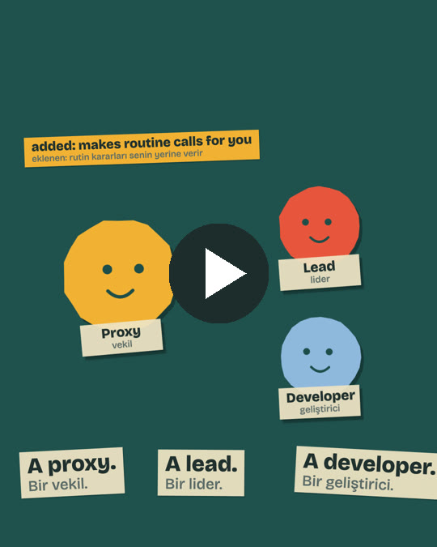
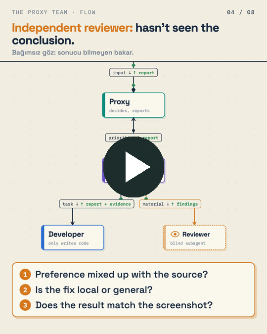

# ProxyTeam (VekilEkip)

**English** · A three-session way of working with Claude Code: you talk only to a *proxy* session, which makes the routine
calls for you and passes work on to a *lead* and a *developer*. Experimental; observations so far, not measurements.

**Türkçe** · Claude Code ile üç oturumlu bir çalışma yöntemi: yalnız *vekil* oturumuyla konuşursunuz; rutin kararları o verir,
işi *lider*e ve *geliştirici*ye iletir. Deneysel; şimdilik gözlem var, ölçüm yok.

<table>
<tr>
<th width="50%">Why · Neden (1:00)</th>
<th width="50%">How the work flows · İş nasıl akar (1:18)</th>
</tr>
<tr>
<td align="center"></td>
<td align="center"></td>
</tr>
</table>

Click a cover to watch. Both videos have an English voice-over, with on-screen headings in both languages. İzlemek için kapağa tıklayın. İlk videonun Türkçe seslendirmeli sürümü: [tanitim/proxyteam-tr.mp4](tanitim/proxyteam-tr.mp4)

| | English | Türkçe |
|---|---|---|
| Guide / Kılavuz | [README.en.md](README.en.md) | [README.tr.md](README.tr.md) |
| Quick start / Hızlı kurulum | [QUICKSTART.en.md](QUICKSTART.en.md) | [HIZLI-BASLANGIC.md](HIZLI-BASLANGIC.md) |
| Step-by-step use / Adım adım kullanım | [USAGE.en.md](USAGE.en.md) | [KULLANIM-TALIMATI.md](KULLANIM-TALIMATI.md) |
| Measurement log / Ölçüm günlüğü | [MEASUREMENT-LOG.en.md](MEASUREMENT-LOG.en.md) | [OLCUM-GUNLUGU.md](OLCUM-GUNLUGU.md) |

The documents and the code comments are in both languages. The kit's working parts (templates the sessions read, script
messages, file names) are in Turkish. First measurement entry: Friday 4 December 2026.

Belgeler ve kod açıklamaları iki dildedir. Kitin çalışan parçaları (oturumların okuduğu şablonlar, betik iletileri, dosya
adları) Türkçedir. İlk ölçüm girişi: 4 Aralık 2026 Cuma.

MIT · Video: voice by ElevenLabs (Brian, Derya), music "Brassy Bubbles" by Technodono (CC0).
