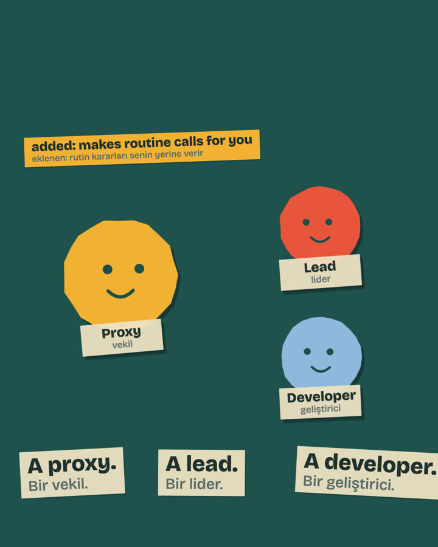

# ProxyTeam (VekilEkip)

**English** · A three-session way of working with Claude Code: you talk only to a *proxy* session, which makes the routine
calls for you and passes work on to a *lead* and a *developer*. Experimental; observations so far, not measurements.

**Türkçe** · Claude Code ile üç oturumlu bir çalışma yöntemi: yalnız *vekil* oturumuyla konuşursunuz; rutin kararları o verir,
işi *lider*e ve *geliştirici*ye iletir. Deneysel; şimdilik gözlem var, ölçüm yok.

  

  ▶ <a href="tanitim/proxyteam-en.mp4">Watch the 60-second video (English)</a> · <a href="tanitim/proxyteam-tr.mp4">60 saniyelik videoyu izle (Türkçe)</a>

| | English | Türkçe |
|---|---|---|
| Guide / Kılavuz | [README.en.md](README.en.md) (summary) | [README.tr.md](README.tr.md) (tam kılavuz) |
| Quick start / Hızlı kurulum | Turkish only | [HIZLI-BASLANGIC.md](HIZLI-BASLANGIC.md) |
| Step-by-step use / Adım adım kullanım | Turkish only | [KULLANIM-TALIMATI.md](KULLANIM-TALIMATI.md) |
| Measurement log / Ölçüm günlüğü | [OLCUM-GUNLUGU.md](OLCUM-GUNLUGU.md) (Turkish) | [OLCUM-GUNLUGU.md](OLCUM-GUNLUGU.md) |

The kit itself (templates, script messages, file names) is in Turkish. First measurement entry: Friday 4 December 2026.

Kitin kendisi (şablonlar, betik iletileri, dosya adları) Türkçedir. İlk ölçüm girişi: 4 Aralık 2026 Cuma.

MIT · Video: voice by ElevenLabs (Brian, Derya), music "Brassy Bubbles" by Technodono (CC0).
